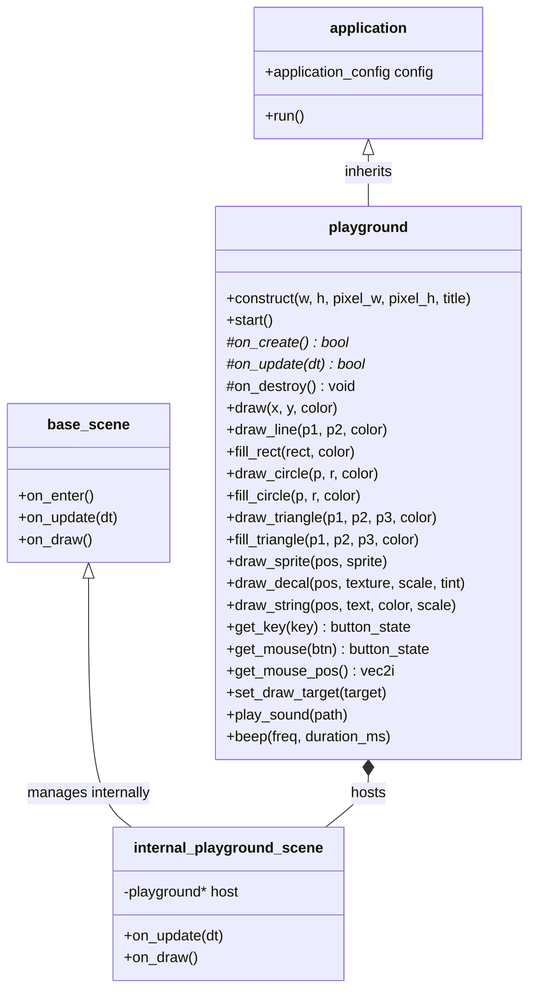

# Neutrino Playground (`neutrino::playground`)
## Design & Implementation Specification: Rapid Prototyping Engine in the Spirit of olcPixelGameEngine

---

## 1. Executive Summary & Vision

### 1.1 The Problem
**Neutrino** is a powerful, modular C++20 game development framework built on top of SDL3, SDL++, Musac audio, OnyxFont, and modern GPU rendering pipelines. However, developing a new idea in Neutrino typically involves boilerplate:
- Subclassing `neutrino::base_scene`
- Instantiating and configuring `neutrino::application`
- Managing scene transitions and stacks
- Configuring camera coordinates, world layers, or sprite caches

When an engineer, game jammer, or researcher wants to:
- Rapidly prototype an algorithm (A*, pathfinding, fluid dynamics, boids, raycasting)
- Build retro pixel-art games (Pico-8, NES, or Commodore-style)
- Experiment with mathematical visualizations or procedural generation
- Create an educational interactive toy in a single `.cc` file under 50 lines

...the ceremony of a full engine architecture introduces unnecessary friction.

### 1.2 The Inspiration: `olc::PixelGameEngine`
[OneLoneCoder's `olcPixelGameEngine`](https://github.com/onelonecoder/olcpixelgameengine) revolutionized hobbyist and educational C++ game programming with its radical simplicity:
1. **Single-class inheritance**: Subclass one class, override `OnUserCreate()` and `OnUserUpdate(dt)`.
2. **Virtual canvas resolution**: Run a 256×240 retro canvas scaled up by 3× or 4× in an integer-scaled window.
3. **Immediate-mode 2D drawing**: `Draw()`, `DrawLine()`, `FillCircle()`, `DrawSprite()`, `DrawString()` work out of the box with zero assets needed.
4. **Instant Input & Math**: Vector math (`vf2d`, `vi2d`), key/mouse states (`bPressed`, `bHeld`, `bReleased`).

### 1.3 The Mission: `neutrino::playground`
Bring the effortless, joy-inducing prototyping experience of `olc::PixelGameEngine` to **Neutrino**, while leveraging Neutrino's modern foundations:
- **Pure Modern C++20**: Value semantics, `std::string_view`, `std::span`, concepts, strong typing.
- **Hardware-Accelerated SDL3**: Backed by Vulkan/OpenGL/Metal rendering via SDL3 and `sdlpp`.
- **Built-in Zero-Setup Font**: Powered out-of-the-box by `onyx_font::bios_font_8x8` (no external font files required).
- **Built-in Audio**: Audio playback and synth tones via Neutrino's `musac` engine.
- **Seamless Graduation Path**: Code written in `neutrino::playground` can smoothly graduate into full Neutrino scenes and modules without rewriting core math or rendering logic.

---

## 2. Architecture & Design



### 2.1 The Host & Scene Decoupling
To eliminate boilerplate while maintaining 100% compliance with Neutrino's runtime lifecycle:
- `neutrino::playground` inherits from `neutrino::application`.
- Internally, `playground::construct()` initializes `application_config`:
  - `logical_size = dim{canvas_width, canvas_height}`
  - `width = canvas_width * pixel_scale_x`
  - `height = canvas_height * pixel_scale_y`
  - `scale_mode = scale_mode::integer_scale` (or `letterbox`)
  - `vsync = vsync ? 1 : 0`
- It registers an internal hidden `internal_playground_scene` as the primary scene.
- Every frame, Neutrino invokes the internal scene's `on_update(dt)` and `on_draw()`, which forwards directly to user overrides `on_update(dt)`.

### 2.2 Virtual Canvas & Coordinate Spaces
```
Window Space: [0, 0] --------------------------------- [1280, 960] (4x Scaled)
                                      |
                      Logical Scaler (SDL3 / Neutrino)
                                      v
Virtual Canvas: [0, 0] ----------------- [320, 240] (User Draw Space)
```
- Users always draw in **virtual canvas pixels** ($0 \le x < \text{width}$, $0 \le y < \text{height}$).
- Mouse inputs are automatically transformed from window space into virtual canvas coordinates via `neutrino::to_render_coords()`. `get_mouse_pos()` returns coordinates in $[0, \text{canvas\_width}-1]$.

---

## 3. Detailed API Specification

### 3.1 "Hello World" Prototype

```cpp
#include <neutrino/playground.hh>

class Starfield : public neutrino::playground {
    struct Star { float x, y, z; };
    std::vector<Star> stars;

    bool on_create() override {
        stars.resize(200);
        for (auto& s : stars) {
            s = { float(rand() % screen_width() - screen_width()/2),
                  float(rand() % screen_height() - screen_height()/2),
                  float(rand() % screen_width() + 1) };
        }
        return true;
    }

    bool on_update(float dt) override {
        clear(colors::black);

        for (auto& s : stars) {
            s.z -= 100.0f * dt;
            if (s.z <= 0) s.z = screen_width();

            int sx = int(s.x / s.z * 100.0f + screen_width() / 2);
            int sy = int(s.y / s.z * 100.0f + screen_height() / 2);

            draw(sx, sy, colors::white);
        }

        draw_string({10, 10}, "Starfield - Neutrino Playground", colors::yellow);
        return true;
    }
};

int main() {
    Starfield demo;
    if (demo.construct(320, 240, 3, 3, "Starfield Demo")) {
        demo.start();
    }
    return 0;
}
```

---

### 3.2 Types & Math Primitives

#### 3.2.1 2D Vectors (`vec2i`, `vec2f`)
A high-ergonomics, constexpr 2D vector type supporting complete arithmetic and common game math:

```cpp
namespace neutrino::pg {
    template <typename T>
    struct vec2 {
        T x{0};
        T y{0};

        constexpr vec2() = default;
        constexpr vec2(T x_, T y_) : x(x_), y(y_) {}

        // Arithmetic
        constexpr vec2 operator+(const vec2& o) const noexcept { return {x + o.x, y + o.y}; }
        constexpr vec2 operator-(const vec2& o) const noexcept { return {x - o.x, y - o.y}; }
        constexpr vec2 operator*(T scalar) const noexcept { return {x * scalar, y * scalar}; }
        constexpr vec2 operator/(T scalar) const noexcept { return {x / scalar, y / scalar}; }

        // Linear algebra
        [[nodiscard]] constexpr T dot(const vec2& o) const noexcept { return x * o.x + y * o.y; }
        [[nodiscard]] constexpr T cross(const vec2& o) const noexcept { return x * o.y - y * o.x; }
        [[nodiscard]] float length() const noexcept { return std::hypot(x, y); }
        [[nodiscard]] vec2<float> normalized() const noexcept { float l = length(); return l > 0 ? vec2<float>(x/l, y/l) : vec2<float>(); }
        [[nodiscard]] constexpr vec2 perp() const noexcept { return {-y, x}; }
    };

    using vec2i = vec2<int>;
    using vec2f = vec2<float>;
}
```

#### 3.2.2 Colors (`color`, `colors::*`)
Transparent alias or wrapper over `sdlpp::color` with standard palette constants:

```cpp
namespace neutrino::pg {
    using color = sdlpp::color;

    namespace colors {
        inline constexpr color black{0, 0, 0, 255};
        inline constexpr color white{255, 255, 255, 255};
        inline constexpr color red{255, 0, 0, 255};
        inline constexpr color green{0, 255, 0, 255};
        inline constexpr color blue{0, 0, 255, 255};
        inline constexpr color yellow{255, 255, 0, 255};
        inline constexpr color magenta{255, 0, 255, 255};
        inline constexpr color cyan{0, 255, 255, 255};
        inline constexpr color dark_gray{64, 64, 64, 255};
        inline constexpr color gray{128, 128, 128, 255};
        inline constexpr color light_gray{192, 192, 192, 255};
        inline constexpr color blank{0, 0, 0, 0};

        [[nodiscard]] constexpr color rgb(uint8_t r, uint8_t g, uint8_t b) { return {r, g, b, 255}; }
        [[nodiscard]] constexpr color rgba(uint8_t r, uint8_t g, uint8_t b, uint8_t a) { return {r, g, b, a}; }
        [[nodiscard]] color hsv(float h, float s, float v, float a = 1.0f);
    }
}
```

---

### 3.3 Drawing System

#### 3.3.1 Primitives
All primitives execute immediately against Neutrino's hardware renderer via [`neutrino/video/draw.hh`](file:///home/igor/proj/neutrino/neutrino/include/neutrino/video/draw.hh):

| Method | Parameters | Description |
|---|---|---|
| `draw(x, y, color)` | `int x, int y, color c` | Single pixel |
| `draw_line(x1, y1, x2, y2, color)` | `int x1, int y1, int x2, int y2, color c` | Line segment |
| `draw_rect(x, y, w, h, color)` | `int x, int y, int w, int h, color c` | Hollow rectangle |
| `fill_rect(x, y, w, h, color)` | `int x, int y, int w, int h, color c` | Solid filled rectangle |
| `draw_circle(cx, cy, r, color)` | `int cx, int cy, int radius, color c` | Circle outline (Midpoint algorithm) |
| `fill_circle(cx, cy, r, color)` | `int cx, int cy, int radius, color c` | Solid filled circle |
| `draw_triangle(p1, p2, p3, color)` | `vec2i p1, vec2i p2, vec2i p3, color c` | Triangle outline |
| `fill_triangle(p1, p2, p3, color)` | `vec2i p1, vec2i p2, vec2i p3, color c` | Solid filled triangle |
| `clear(color)` | `color c = colors::black` | Clear active draw surface |

#### 3.3.2 Sprites & Decals (RAM vs VRAM)
Following `olcPixelGameEngine`'s dual image design:
- **`pg::sprite` (CPU/RAM surface)**:
  - For per-pixel CPU manipulation, procedural textures, heightmaps, cellular automata.
  - Direct read/write access: `get_pixel(x, y)`, `set_pixel(x, y, col)`.
  - Drawn via `draw_sprite(pos, sprite)`.
- **`pg::decal` (GPU texture)**:
  - Wrapped around `sdlpp::texture` / `neutrino::render_texture`.
  - Fast hardware scaling, rotation, shearing, tinting:
    ```cpp
    draw_decal(pos, decal, scale = {1, 1}, tint = colors::white, angle = 0.0f, origin = {0, 0});
    draw_warped_decal(decal, std::array<vec2f, 4> quad, tint);
    ```

#### 3.3.3 Built-in Typography
Integrated with Neutrino's `onyx_font::bios_font_8x8`:
- Zero external font files required!
- Scalable by integer factor `scale`:
```cpp
draw_string(x, y, "Score: 1200", colors::yellow, scale = 2);
```

#### 3.3.4 Render-To-Texture Targets
Users can redirect all drawing commands to a texture target:
```cpp
set_draw_target(my_render_texture);
clear(colors::blank);
fill_circle(16, 16, 12, colors::red);
set_draw_target(nullptr); // Restores screen canvas
```

---

### 3.4 Input System

The input polling mirrors `olc` simplicity:

```cpp
struct button_state {
    bool pressed{false};   // Just triggered this frame
    bool held{false};      // Continuously held down
    bool released{false};  // Just released this frame
};

// Keyboard
button_state get_key(sdlpp::key_code k) const;

// Mouse
button_state get_mouse(sdlpp::mouse_button b) const;
vec2i get_mouse_pos() const; // Virtual canvas coordinates!
int get_mouse_x() const;
int get_mouse_y() const;
float get_mouse_wheel() const;
```

---

### 3.5 Audio Integration (`pg::audio`)

Powered by Neutrino's `musac` and PC speaker emulation:

```cpp
// One-liner sound effect
play_sound("data/sound/jump.wav", volume = 1.0f);

// Background streaming music
play_music("data/music/theme.ogg", loop = true);
stop_music();

// Game Jam retro square-wave tone generator
beep(440.0f /* A4 Hz */, 150 /* ms */);
```

---

## 4. Implementation Strategy

### 4.1 Project Placement in Neutrino
```
neutrino/
├── include/neutrino/
│   └── playground/
│       ├── playground.hh         <- Main public header
│       ├── types.hh              <- vec2i, vec2f, color constants
│       ├── sprite.hh             <- CPU sprite surface
│       └── decal.hh              <- GPU decal texture
├── src/neutrino/
│   └── playground/
│       ├── playground.cc         <- Application & rendering bridge
│       ├── primitives.cc         <- Circle, triangle, rasterization helpers
│       └── font_render.cc        <- onyx_font::bios_font_8x8 blitter
└── examples/
    └── playground/
        ├── 01_bouncing_balls/
        ├── 02_game_of_life/
        ├── 03_raycaster/
        └── 04_particles/
```

### 4.2 CMake Integration
To enable instant usage without adding extra library dependencies:
- Integrate `neutrino_playground` directly into `neutrino::neutrino` target (or as an optional component `neutrino::playground`).
- Inherits all public dependencies: `sdlpp`, `musac`, `onyx_font`, `onyx_image`.

---

## 5. Graduation Path: From Playground to Production Game

One major weakness of standalone prototyping libraries is that when a prototype succeeds, the game must be completely rewritten in a commercial engine.

In `neutrino::playground`, graduating a prototype is effortless:
1. The playground's `on_update(float dt)` translates 1:1 into a `neutrino::base_scene::on_update(dt)` and `on_draw()`.
2. Math types (`vec2i`, `vec2f`) and colors (`sdlpp::color`) are already first-class Neutrino types.
3. The primitive draw calls (`draw_line`, `fill_rect`, `draw_circle`) are direct wrappers over `neutrino::draw_*` in [`draw.hh`](file:///home/igor/proj/neutrino/neutrino/include/neutrino/video/draw.hh).
4. Audio calls map directly to `neutrino::load_sfx` and `neutrino::play_music`.

The transition from a 1-file playground hack to a structured multi-scene, multi-layer game takes minutes without rewriting game logic.
