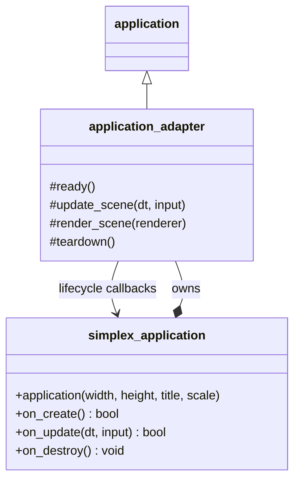

# Neutrino Playground (`neutrino::playground`)

Design proposal for small interactive programs inspired by olcPixelGameEngine.

**Status:** the runtime facade is implemented as `neutrino::simplex::application`,
with `SIMPLEX_MAIN` as its entry point. Sections 2 and 3.5 describe that runtime
and its input contract. The CPU canvas, drawing conveniences, and example programs
remain proposed work; the current canvas is a persistent render-target texture.
The historical Playground name below refers to this Neutrino facade, while SDL++
Simplex is the older module being retired.

## 1. Purpose and scope

Playground should make a short experiment easy to start: create one class, choose
a logical canvas size, and implement a frame callback. Its intended uses include
pixel art, cellular automata, raycasting, procedural graphics, and educational
visualizations. A first program should need one source file and no external assets.

The useful lessons from the inspected olcPixelGameEngine checkout are its small
lifecycle, persistent CPU pixel canvas, accessible input, embedded font, and images
drawn over the canvas. Playground implements that composition with Neutrino's
existing sprite subsystem.
It does not promise OLC source compatibility or identical rasterization.

Playground is also the successor to SDL++'s Simplex module. Migrate its distinct
capabilities into reusable Neutrino components, expose convenient Playground APIs,
and retire Simplex once its consumers and useful examples have migrated.
**Playground must have no Simplex dependency**, including during its implementation.

The first version includes:

- One window with a fixed logical resolution, uniform integer scaling, and resize support.
- One `on_create()` callback, one `on_update(dt, input)` per frame, and one shutdown hook.
- A persistent CPU canvas, clipped primitives, CPU image blits, and embedded text.
- Existing Neutrino sprites and text overlays with explicit composition order.
- Keyboard and mouse polling in logical canvas coordinates.
- Image loading through the existing Neutrino image loader.

Mesh effects, motion sequencing, and the optional WGT asset loader follow the
initial canvas work as part of the Simplex migration. Audio conveniences,
fixed-step callbacks, render targets, layers, and richer text can follow concrete
examples. These additions should not delay the four small programs in section 6;
finishing those programs alone does not complete Simplex's retirement.

Optional image resizing and pixel-art presentation filters use the existing
`scaler` library. Scaler remains a separate library owning those algorithms;
Neutrino supplies adapters and Playground supplies a convenient interface.

### 1.1 Simplex succession and component destinations

The sibling `lib_sdlpp` repository already contains `simplex`, an earlier small-game
layer with substantial overlap. Preserve useful behavior while consolidating its
implementation into Neutrino. Simplex source paths in this table are relative to
`lib_sdlpp`; links point to existing Neutrino replacements.

| Simplex component | Decision | Destination and evolution |
| --- | --- | --- |
| `sprite_mesh` and effects (`include/simplex/mesh.hh`, `include/simplex/effects.hh`) | Migrate | Reusable mesh/deformation components in Neutrino's video layer; Playground queues their rendering using managed texture handles. |
| Movement queue and easing (`include/simplex/sprite.hh`, `src/simplex/sprite.cc`) | Extract | A small Neutrino motion-sequence utility independent of sprite images, animation clocks, and renderers. |
| CPU fire buffer and upload (`examples/simplex/example_fire.cc`) | Generalize | Playground's persistent CPU canvas, dirty upload, logical presentation, and managed shutdown. |
| WGT loader (`src/simplex/sprite_atlas.cc`) | Migrate separately | An optional Neutrino asset loader using `lib_bstream`, producing CPU image/atlas data before GPU upload. |
| Atlas ownership, frame rectangles, and collision masks (`include/simplex/sprite_atlas.hh`) | Replace with existing components | [CPU atlases](../include/neutrino/video/sprite/cpu_texture_atlas.hh), [GPU atlases](../include/neutrino/video/sprite/texture_atlas.hh), and [bitmasks](../include/neutrino/video/sprite/bitmask.hh); add only missing conveniences. |
| Frame animation (`include/simplex/sprite.hh`) | Replace with existing components | [Animation definitions](../include/neutrino/video/sprite/sprite_animation.hh), [playback state](../include/neutrino/video/sprite/sprite_state.hh), and [sprite builders](../include/neutrino/video/sprite/sprite_def_builder.hh). |
| Collision math and display bridge (`include/simplex/collide/shapes.hh`, `include/simplex/collide/bridge.hh`) | Consolidate | Existing [Neutrino physics geometry](../include/neutrino/physics/geometry/shapes.hh); preserve useful test cases and explicit coordinate conversion, without another collision implementation. |
| Application and primitive wrappers (`include/simplex/simplex.hh`, `src/simplex/simplex.cc`) | Retire after consumer migration | Neutrino's application adapter and existing SDL++/Neutrino rendering operations, with the CPU/GPU distinction defined below. |
| `dp` and duplicate geometry (`include/simplex/dp.hh`, `include/simplex/geometry.hh`) | Retire after consumer migration | Existing Neutrino geometry and logical canvas coordinates; remove process-wide scale from the migrated API. |
| Examples and tests (`examples/simplex/`, `test/simplex/test_collide.cc`, `test/video/test_sprite_atlas.cc`) | Port selectively | Playground demonstrations and Neutrino component tests with meaningful behavioral assertions and portable assets. |

Simplex currently submits its primitives directly to the GPU renderer. Its base
`on_render()` presents the frame, so its basic example can draw during `on_update()`.
Neutrino clears the backbuffer before scene rendering; that execution pattern
cannot be transferred unchanged. Simplex's `dp` conversion also rounds after
applying a process-wide display scale, while Playground uses a fixed logical
canvas and lets SDL handle presentation scaling. Even the free `draw_sprite()`
helper converts positions through `dp::px()`; its explicit scale argument alone
does not remove that dependency.

The fire example proves that a CPU buffer plus texture upload already has a local
precedent. It is implemented inside the demo, however, rather than exposed as a
reusable persistent canvas. Generalizing that path, adding the embedded text API,
and integrating sprite batching and ownership remain Playground work. Review the demo's
failure paths before reuse: texture creation can return early while subsequent
updates still assume an initialized CPU buffer. It also selects linear sampling,
which must change to nearest-neighbor for the proposed pixel-art presentation.

For migrated Simplex capabilities, the ownership rule is one implementation in
Neutrino, accessible to both regular scenes and Playground. SDL++ provides its low-level
surface, texture, renderer, and input facilities. Migrated code must not include
Simplex headers, retain its global scale, or link its library. Do not derive from
both application classes or run two event loops.

### 1.2 Contracts for the distinctive components

**Mesh effects.** Preserve subdivided sprite meshes, horizontal/vertical waves,
skew, taper, pinch/punch, and projected rotation. Keep undeformed geometry as a
baseline and apply each frame's effects to a fresh working copy; intentional
composition within a frame must not accidentally accumulate across frames. Use
logical coordinates and explicit texture ownership. Queue an owned snapshot of
the final vertices/indices, or an equivalent immutable payload, so modifying the
source mesh after submission cannot alter an earlier draw command. Keep UVs and
texture sampling explicit. Simplex's current `perspective_effect` is geometric
tapering; it does not establish OLC-equivalent perspective-correct texturing.

**Motion sequencing.** Extract relative offsets, durations, easing, cancellation,
and propagation of unused elapsed time into subsequent steps. A proposed
`neutrino::motion_sequence` advances a position without owning an image or animation
clock, so it can drive a sprite, camera, label, or particle. Use explicit elapsed
seconds and documented coordinate units. Define zero-duration steps as immediate,
reject negative/non-finite durations and deltas, and verify finite easing
results. Test a delta crossing several steps, cancellation, and completion. Use
Neutrino's existing animation machinery for frame playback; the sequence must not
introduce a second animation clock for the same sprite.

**WGT assets.** Split file decoding from atlas packing and texture creation. Use
`lib_bstream` with explicit byte order, validate supported versions, bound reads
and allocations, and check dimension/product overflow before allocating pixels.
Preserve the file's sprite identifiers, empty slots, palette information, and
transparency semantics through the CPU representation or explicit metadata. Use
existing Neutrino atlas construction for upload. This is an optional asset-format
API; Playground startup and generated examples must not require WGT files.

**Tests and examples.** Port the intent of existing tests and reconcile overlapping
coverage with Neutrino. Several current mesh/effect checks only verify vertex
count after applying an effect. Add assertions for expected positions, UVs,
identity settings, and repeated-frame behavior. Atlas, motion, and loader tests
should cover lifetime, timing, sparse sprite identifiers, and malformed/truncated
input. The new canvas, input mapping, and shutdown contracts still need their own
checks. Replace machine-specific asset paths in migrated demos with generated or
bundled assets, or an explicit optional command-line path.

### 1.3 Reuse Scaler for image resizing

The sibling `scaler` repository provides whole-image CPU resizing, pixel-art
filters, an algorithm capability database, and OpenGL GPU implementations.
Borrow OLC's convenient image operations while keeping scaling algorithms in
Scaler. The first Playground version still works without this optional integration.

| Operation | Implementation owner | Playground responsibility |
| --- | --- | --- |
| Resize a CPU surface or generated image | Scaler CPU algorithms | Adapt the surface, validate dimensions and format, and reuse output storage where possible. |
| Filter the canvas with EPX, HQ, xBR, or another supported algorithm | Scaler through a Neutrino adapter | Select a supported algorithm/backend/factor and cache the presentation result. |
| Ordinary nearest-neighbor presentation | Existing SDL renderer | Fit the logical canvas into the window without invoking a separate resize pass. |
| Sample one image value at arbitrary UV coordinates | A small image-sampling utility | Define nearest/bilinear sampling and clamp, repeat, or transparent-border addressing. Whole-image resizing does not directly provide this API. |

Relevant source paths, relative to `scaler`, are
`include/scaler/unified_scaler.hh`, `include/scaler/algorithm_capabilities.hh`,
`include/scaler/sdl/sdl_image.hh`, and
`include/scaler/gpu/sdl/sdl_texture_adapter.hh`. Consult the capability database
and implementation for supported factors; do not assume every filter supports
the same scales on CPU and GPU. If interpolation helpers can be shared with the
UV sampler, extract them at the appropriate library boundary rather than resizing
an entire image to answer a single sample request.

Two integration gaps in the inspected code must be handled explicitly:

- The CPU SDL adapter uses `uvec3`, `SDL_GetRGB`, and `SDL_MapRGB`, discarding source
  alpha. It is suitable for an explicitly opaque presentation buffer. General
  transparent sprite resizing needs alpha-preserving support in Scaler and tests
  for transparent edges; do not silently make sprites opaque.
- The GPU SDL adapter requires an OpenGL renderer. Its presence does not establish
  support for SDL's other renderer backends. Start with portable CPU filtering;
  enable GPU filtering only when backend, context, algorithm, and factor support
  have been verified. Backend resources must follow Neutrino's teardown lifecycle.

## 2. Runtime architecture

### 2.1 Composition and the current engine API

[`simplex::application`](../include/neutrino/simplex/application.hh) owns a private
`application_adapter` derived from `neutrino::application`. The facade defines the
user's boolean continuation callback; the adapter integrates it with the engine's
window, services, and final SDL callbacks. Configuration is supplied to the facade's
constructor, and [`SIMPLEX_MAIN`](../include/neutrino/simplex/entry_point.hh) drives
startup and shutdown.



The engine keeps common frame bookkeeping in its final callbacks:

- `application::on_update()` dispatches audio callbacks, advances sprite animations,
  captures one input snapshot, and calls `update_scene(dt, input)` once per frame.
- `application::on_render()` clears the renderer, calls `render_scene(renderer)`,
  presents the frame, and clears transient gamepad input. SDL++ clears keyboard
  and mouse transients when iteration completes.
- `application::handle_event()` maintains gamepad state, detects render-space size
  changes, calls `resize_scene(size)` when the size changes, and calls `event(e)`.
  The default hooks notify the scene stack and contain scene exceptions. Overrides
  replace scene dispatch; they can explicitly call the base implementation to retain it.
  Initial scene sizing still occurs when a scene enters or resumes; a custom
  application can query `render_size()` in `ready()` for its initial size.

The default `update_scene()` drives the scene stack's fixed-step scheduler,
contains scene exceptions, and exits when a previously populated stack becomes
empty. The default `render_scene()` draws that stack and handles scene failures.
The adapter overrides both hooks: it forwards a frame update to the user and
presents the persistent canvas. Its callbacks run independently of scene-stack
scheduling. A subclass that wants scene updates or drawing in addition to custom
behavior can explicitly call the corresponding base implementation. Scene-update
failure suppression lasts only for the current frame, even when custom rendering
does not call the default renderer.

The Simplex adapter also overrides `event()` and `resize_scene()` with no-ops:
input comes from the frame snapshot, and SDL presentation scales its fixed canvas.
Queued scene transitions ignored by an event override remain owned by the scene
manager and are reclaimed at shutdown without entering those scenes.

The adapter does not resample input. The engine captures it before the adapter
binds its canvas, so pointer mapping uses the window's presentation settings.
Cleanup runs in `teardown()` while engine services are alive.

### 2.2 Configuration and lifecycle

Current public lifecycle API, in `neutrino::simplex::application`:

```cpp
application(int width_px, int height_px, const std::string& title, float scale = 1.0f);
virtual bool on_create(); // default: true
virtual bool on_update(float dt, const neutrino::input_snapshot& input) = 0;
virtual void on_destroy(); // default: no-op
```

The constructor validates positive dimensions and finite positive scale, checks
scaled window dimensions before conversion to `int`, and constructs the adapter.
It does not initialize SDL or allocate the canvas. Logical dimensions remain
`width_px` by `height_px`; the initial window dimensions are multiplied by scale
and fractional window points are truncated. Presentation uses integer scaling.
Uniform scale is intentional. HiDPI can change the window's physical pixel size.

Include `<neutrino/simplex/entry_point.hh>` in the main source file and use
`SIMPLEX_MAIN(DerivedApplication, constructor_arguments...)`. The entry point owns
the user object and initializes SDL, the window, renderer, and engine services
before calling `on_create()`. It tears down the runtime and user object while SDL
is still available. There is no separate `construct()` / `start()` API.

| Engine hook | Adapter responsibility |
| --- | --- |
| `ready()` | Allocate and initialize the persistent canvas, then enter `on_create()`. Planned CPU drawing and font resources join this stage. |
| `update_scene(float dt, const input_snapshot& input)` | Bind the canvas, forward the existing snapshot to `on_update(dt, input)` once, restore the previous target, and stop if the callback returns false. Planned sprite batching also begins here. |
| `render_scene(sdlpp::renderer&)` | Draw the canvas. The planned CPU path uploads dirty pixels first and flushes the sprite batch afterward. |
| `teardown()` | Stop callbacks, invoke the user's shutdown hook when applicable, and release owned device resources while services are alive. Discard any future queued draws before releasing their owners. |

Returning false from `on_create()` means initialization failed and produces
`SDL_APP_FAILURE`. Returning false from `on_update()` requests a normal exit;
do not promise presentation of that frame's canvas changes. Closing the window
is also a normal exit. No further user frame callbacks run after a stop request.

Call `on_destroy()` exactly once if `on_create()` was entered, including when it
returns false or throws after creating resources. Do not call it if startup
failed before entering `on_create()`. Internal cleanup must run in both cases.

Uncaught creation or frame-callback failures reach the entry point and become
`SDL_APP_FAILURE`. The adapter's update and render overrides run outside the
scene-stack exception handlers. Exceptions from `on_destroy()` are logged and
contained so resource cleanup completes; cleanup is never retried. User virtual
callbacks are not invoked from the facade's destructor.

### 2.3 Frame timing

The adapter's `update_scene(float, const input_snapshot&)` runs once per engine
frame and forwards the raw frame delta to the user's combined logic-and-drawing
callback. It replaces the default scene scheduler, so the callback is never
converted into fixed physics ticks. In the default scene path, the first substep
receives input edges and subsequent substeps receive `without_edges()` copies.

Pass frame delta in seconds. Neutrino's `fixed_step_config::max_frame` clamps its
fixed-step accumulator, not this callback's delta. Examples that need bounded
simulation time must clamp it or use an explicit accumulator, as described below.

The frame sequence is:

1. The engine captures one immutable input snapshot, then calls the adapter's
   `update_scene(dt, input)`. The planned overlay path starts an empty screen-space
   `sprite_batch` here.
2. Run `on_update(dt, input)`: CPU drawing changes persistent pixels; sprite and
   overlay text calls add entries to the batch.
3. Let [`application::on_render()`](../src/neutrino/application.cc) clear the backbuffer.
4. In the adapter's `render_scene(renderer)`, update the canvas presentation texture and
   draw it. The default path uploads the dirty CPU canvas once; optional Scaler
   filtering uses the cached presentation stage in section 3.1.1.
5. Flush the sprite batch within the same hook. Use equal layer and depth values
   for the default insertion order. The engine then presents the frame and clears
   transient input state.

In the planned CPU path, do not submit immediate hardware drawing from `on_update()`: the engine clears it
before the render hook. Draw into the persistent canvas or queue existing sprite
visuals for rendering there. Do not call the user callback from `fixed_update()`.

## 3. Canvas, resources, and input

### 3.1 Persistent CPU pixels and sprite overlays

The default draw target is a CPU surface initialized to opaque black. Pixels
persist between frames until changed; `clear()` is an explicit operation. Drawing
marks the canvas dirty. The first implementation may conservatively mark an entire
canvas dirty after a valid write; dirty rectangles can follow profiling.

Start with a fixed RGBA format and respect row pitch. In the default presentation
path, upload at most once per rendered frame when the canvas is dirty; a clean
frame still draws the existing canvas texture.
Use nearest-neighbor sampling by default. Optional Scaler filtering is specified
in section 3.1.1. Reuse SDL++'s `surface_renderer` for
CPU primitives where its clipping and blending satisfy the contract, and SDL++'s
streaming texture update/lock facilities for presentation. Measure before adding
new rasterizers or optimizing individual dirty regions.

Composition has two explicit stages:

| Operation | Storage and lifetime | Ordering |
| --- | --- | --- |
| `clear`, `draw`, primitives, `draw_image`, `draw_string` | Persistent CPU canvas | Applied immediately, in call order. |
| Facade `draw_sprite`, `draw_overlay_string` | Existing `sprite_batch` for this frame | Drawn after the complete canvas; equal layer/depth preserves insertion order. |

A CPU `draw_string()` called after queuing a sprite still appears underneath that
sprite. Queue `draw_overlay_string()` last for a HUD that must appear on top.
Batch entries do not persist and must be submitted again each frame. Enqueue them
only during `on_update()`; canvas initialization and resource creation are also
allowed in `on_create()`. `clear()` changes CPU pixels; it does not remove queued
sprites. Both composition stages run inside the adapter's single `render_scene()`
override.

CPU primitives, image blits, and glyphs use straight-alpha source-over blending.
`clear()` and direct pixel replacement store the supplied RGBA values. CPU images
use `sdlpp::surface`; convenience pixel access must define out-of-bounds reads as
transparent black and ignore out-of-bounds writes. Drawing is clipped. Nonpositive
rectangle sizes and negative radii draw nothing. Clip before iteration and avoid
signed overflow for extreme coordinates. The canvas texture is alpha-composited
onto the engine's black backbuffer; sprite overlays use the shared sprite
renderer's alpha-blending path. Document these choices as Playground behavior,
rather than assuming they match OLC's selectable pixel modes.

#### 3.1.1 Optional Scaler presentation stage

Filtering changes presentation while preserving the logical canvas dimensions,
simulation coordinates, and mouse mapping. The initial integration filters the
CPU canvas and then draws the queued GPU sprites and HUD. CPU-rendered text is
part of the filtered canvas; GPU text remains outside the filter. Filtering the
fully composed scene would require a separate render-target design and is deferred.

For the first CPU integration, composite canvas pixels over the same black
background used by normal presentation into an opaque scratch surface before
passing them to the current RGB adapter. Preserve the original RGBA canvas for
pixel access and subsequent drawing. This explicit flattening is limited to
presentation; it is not a transparent sprite-resizing implementation.

The presentation path should:

1. Validate the chosen filter factor and backend using Scaler's capabilities, then
   calculate checked output dimensions. Keep the filter's intermediate scale
   separate from the window's display scale; algorithms with fixed factors cannot
   be requested at arbitrary ratios. SDL fits the result into the same logical
   canvas rectangle, with nearest-neighbor sampling for the final presentation.
2. Allocate scratch/output storage and the presentation texture once per required
   size/format. Use Scaler's preallocated-output interface rather than allocating
   a new image every frame.
3. Recompute when the canvas revision, filter parameters, selected backend, or
   intermediate output dimensions change. A window resize only requires rescaling
   if it changes those dimensions. GPU-overlay movement alone must not dirty the
   CPU canvas or rerun its filter.
4. Upload the CPU-filtered result once after recomputation and reuse its texture
   on unchanged frames. The default path needs only the original canvas upload;
   the CPU-filtered path needs only the filtered result upload. A future GPU path
   uploads changed source pixels and generates the result on the GPU.
5. Flush the sprite batch after drawing the canvas and before presenting the
   frame. Release scratch textures and GPU filter resources while the
   renderer/context is still valid.

Expose the requested and active algorithm/backend/factor in the comparison demo.
Unsupported requests must yield a clear diagnostic. Use a CPU implementation of
the same filter when available and fallback is allowed; switching to another
filter or ordinary nearest presentation must be an explicit, reported fallback.
Default Playground startup must not require an OpenGL renderer or any filter.

### 3.2 Reuse Neutrino sprites and ownership

Playground is a convenience layer over Neutrino's sprite subsystem. Use its
existing assets, identifiers, registries, animation clocks, and resource owners.

| Responsibility | Existing component |
| --- | --- |
| Editable CPU image | `sdlpp::surface`, loaded through [`load_image()`](../include/neutrino/video/image_loader.hh) or generated in memory; [`cpu_texture_atlas`](../include/neutrino/video/sprite/cpu_texture_atlas.hh) adds frame metadata when needed. |
| Define a single image, sheet, or animation | [`sprite_def_builder`](../include/neutrino/video/sprite/sprite_def_builder.hh), including `from_surface()` for generated images. |
| Upload and resolve named frames/clips | [`sprite_set`](../include/neutrino/video/sprite/sprite_set.hh), `build_sprite_set()`, and the existing atlas/sheet registries. |
| Share uploaded assets and own animation instances | [`acquire_sprite()`, `sprite_set_handle`, and `sprite_instance`](../include/neutrino/video/sprite/sprite_cache.hh). |
| Refer to what should be drawn | `sprite_visual_ref` for a static frame; `sprite_state_id` for a fixed or animated runtime state. |
| Apply scale, flips, and rotation | [`sprite_draw_params` and `draw_sprite()`](../include/neutrino/video/draw.hh). |
| Queue overlays | A screen-space [`sprite_batch`](../include/neutrino/video/world/sprite_batch.hh), with equal layer/depth values for insertion order. |
| Own uncached registered resources | [`render_bundle`](../include/neutrino/video/sprite/render_bundle.hh), which releases states, animations, sheets, and atlases in dependency order. |

A generated image can be a sprite definition with one visual covering its full
surface. Existing sets and animation instances work through the same path.
Facade helpers should hide repetitive setup while returning existing Neutrino
types. CPU surfaces remain independently editable; changing one does not change
an already-uploaded sprite. Source pixels need only remain available for the
build/upload operation, unless the caller also wants to edit or sample them later.

The current `sprite_batch` stores borrowed identifiers. Keep the owning
`sprite_set`, `sprite_set_handle`, or `sprite_instance` alive until the batch is
flushed or discarded. A copied set lease keeps its assets resident, but does not
keep an independently destroyed runtime state alive. Helpers that promise to
retain queued assets must retain existing leases explicitly. Raw-ID overloads
retain the caller's ownership obligation.

Discard the batch before releasing its owners during shutdown. The adapter
releases its font assets, retained leases, and other device resources from
[`application::teardown()`](../include/neutrino/application.hh), while the shared
services are still available. User-owned resources follow the existing Neutrino
ownership rules; the facade must not imply that batching an ID transfers ownership.

Extend shared components only where the examples need missing behavior:

- The public atlas API currently has registration/removal but no pixel-update
  operation. Add an explicit update there if needed, with format, dimensions,
  and cache-sharing rules. Keep cached assets immutable; rebuild/reacquire a changed
  definition, or use a separately owned mutable resource. Never silently edit an
  atlas shared by unrelated cache users.
- `sprite_draw_params` currently supports uniform scale, flips, and rotation.
  Add tint or further transforms to the shared renderer when required. The initial
  overlay API inherits existing transform and pixel-rounding behavior.
- Any stronger retention or stale-handle guarantees belong in the shared resource
  and batching facilities, with tests. Existing raw identifiers alone do not
  establish those guarantees.

Explicit resource creation and image decoding failures use the existing engine
error conventions. Adapter failures propagate to the entry point. Preserve the
batch's current draw-error policy unless it is deliberately extended in the shared
API; `sprite_batch::flush()` currently discards returned draw errors. Expected
clipping remains a normal drawing operation.

### 3.3 Reuse existing types

Do not introduce a second vector implementation. Proposed convenience names are
aliases to existing types:

```cpp
namespace neutrino::pg {
    using point = neutrino::point;
    using pointf = neutrino::world_point;
    using rect = neutrino::rect;
    using color = sdlpp::color;
    using button_state = neutrino::button_state;
    namespace colors = sdlpp::colors;
}
```

Use the existing [geometry vocabulary](../include/neutrino/video/geometry_types.hh)
and Euler facilities where mathematical vectors are needed. A floating drawing
point does not replace the engine's distinct `world_pos`, `world_delta`, and other
[coordinate types](../include/neutrino/coordinates.hh); conversions remain explicit.

### 3.4 Drawing and text API

These are proposed member signatures; `pg` denotes `neutrino::pg`:

```cpp
int screen_width() const noexcept;
int screen_height() const noexcept;
void clear(pg::color color = pg::colors::black);
void draw(int x, int y, pg::color color);
void draw_line(pg::point from, pg::point to, pg::color color);
void draw_rect(pg::rect bounds, pg::color color);
void fill_rect(pg::rect bounds, pg::color color);
void draw_circle(pg::point center, int radius, pg::color color);
void fill_circle(pg::point center, int radius, pg::color color);
void draw_triangle(pg::point a, pg::point b, pg::point c, pg::color color);
void fill_triangle(pg::point a, pg::point b, pg::point c, pg::color color);
void draw_image(pg::point pos, const sdlpp::surface& image);
void draw_string(pg::point pos, std::string_view text,
                 pg::color color = pg::colors::white, int scale = 1);

// Queue existing Neutrino sprites for this frame; owners must survive the flush.
void draw_sprite(pg::pointf pos, neutrino::sprite_visual_ref visual,
                 const neutrino::sprite_draw_params& params = {});
void draw_sprite(pg::pointf pos, neutrino::sprite_state_id state,
                 const neutrino::sprite_draw_params& params = {});
void draw_overlay_string(pg::point pos, std::string_view text,
                         pg::color color = pg::colors::white, int scale = 1);
```

The facade's `draw_sprite()` overloads enqueue into its frame batch; the existing
free `neutrino::draw_sprite()` functions submit immediately to the active renderer.
Use the free functions within a render pass. CPU `draw_image()` blits pixels into
the persistent canvas and does not register a sprite.

Use existing sprite-transform validation and require positive text scales.
Subrectangles and animation come from sprite definitions and states. Mesh effects
and additional transforms extend the shared video layer as described in section
1.2. The proposed overlay text color parameter requires adding tint support to
`sprite_draw_params` and its shared rendering path when implementing that helper.

Both text paths use `onyx_font::bios_font_8x8()`. The CPU path blits glyph masks;
the overlay path builds a normal sprite sheet for the glyph atlas once and queues
its visuals into the same sprite batch. Expand text into glyph entries before the
call returns, so a temporary `string_view` is never retained. Support ASCII and
newlines first, replacing unsupported bytes with `?`; CP437 and UTF-8 decoding
need an explicit later API. No font file is required.

### 3.5 Input and logical coordinates

Use the existing [`input_snapshot`](../include/neutrino/input/input_snapshot.hh)
passed to `on_update(float dt, const input_snapshot& input)`:

```cpp
input.pressed(sdlpp::scancode::space); // one-frame edge
input.held(sdlpp::scancode::left);
input.mouse(sdlpp::mouse_button::left); // pressed / released / held
input.wheel();
input.pointer().window; // window coordinates
input.pointer().render; // logical canvas coordinates
input.pointer().on_screen;
input.gamepad_button_state(0, sdlpp::gamepad_button::south);
```

The engine samples once per frame whether or not scenes exist. Simplex receives
the same snapshot by const reference; repeated reads do not consume edges or
query live device state again. The reference is valid during the callback. Copy
the value if it must be retained afterward. Input transients are cleared at frame
completion, after drawing, so press/release and wheel events remain visible for
the whole frame.

The engine maps the live window pointer through
[`to_render_coords()`](../src/neutrino/video/globals.cc) before the adapter binds
the canvas. Use `input.pointer().render` directly, then floor when integer pixel
indices are needed. Mapping does not clamp. To determine whether the mouse is
inside the canvas, require `pointer().on_screen` and logical coordinates within
`[0, width)` and `[0, height)`. Window presence alone includes letterbox bars.
Coordinates may be negative or exceed the canvas dimensions; examples must check
bounds before painting or selecting cells.

Resizing changes presentation, not canvas dimensions or stored pixels. Test
letterboxing, HiDPI mapping, and small windows; a future minimum-size policy must
allow the canvas to fit at 1x rather than assume an integer scale always exists.

## 4. Smallest useful program

This uses the implemented lifecycle and input signature with the proposed canvas
conveniences; it will compile once those drawing methods exist. The full starfield
is specified in section 6.1.

```cpp
#include <neutrino/simplex/entry_point.hh>

class Hello final : public neutrino::simplex::application {
public:
    Hello() : application(320, 240, "Hello, Simplex!", 3.0f) {}

    bool on_update(float, const neutrino::input_snapshot& input) override {
        clear(sdlpp::colors::black);
        fill_circle({160, 100}, 20, sdlpp::colors::cyan);
        draw_string({16, 140}, "Hello, Simplex!");
        return !input.pressed(sdlpp::scancode::escape);
    }
};

SIMPLEX_MAIN(Hello)
```

## 5. Implementation and retirement sequence

### 5.1 Playground foundation

Proposed placement:

```text
include/neutrino/playground.hh              # umbrella header
include/neutrino/playground/
    playground.hh                          # public facade and callbacks
    types.hh                               # aliases, no new math implementation
src/neutrino/playground/
    playground.cc                          # lifecycle and application adapter
    canvas.cc                              # CPU drawing and dirty upload
    sprite_draw.cc                         # existing sprite_batch integration
    font_render.cc                         # CPU glyphs and shared sprite-sheet atlas
examples/playground/
    CMakeLists.txt
    01_starfield.cc
    02_game_of_life.cc
    03_raycaster.cc
    04_sprite_hud.cc
```

1. Inventory Simplex consumers, examples, tests, headers, and CMake references;
   record each destination from section 1.1. Start the canvas upload work from the
   fire demo's approach, with explicit error handling and no Simplex linkage.
2. Implement the adapter, startup/exit contract, logical resolution, and input.
3. Add the persistent canvas, primitives, CPU font, and starfield.
4. Add CPU image blits and Game of Life; verify pixel persistence and clipping.
5. Add the raycaster and measure the per-pixel path before optimizing it.
6. Integrate existing sprite sets, cache leases, animation instances, and
   screen-space batching; add overlay text and the sprite/HUD program. Put any
   needed pixel-update or tint support in the shared sprite subsystem.

Compile the implementation into the existing `neutrino::neutrino` target. Add the
four executables under the existing `NEUTRINO_NEUTRINO_BUILD_EXAMPLES` option,
linked only to `neutrino::neutrino`. The public include remains
`<neutrino/playground.hh>`. Reuse dependencies already linked by Neutrino; a separate
library target or new dependency-fetching layer is unnecessary for the first version.

Simplex currently has its own library target, with `neutrino::simplex` and
`simplex::simplex` aliases, created when both `SDLPP_WITH_IMAGE` and `SDLPP_WITH_FONT`
are enabled. Do not link those targets from Playground or from migrated Neutrino
components. Move selected implementation code and tests to their Neutrino owners;
reuse existing Neutrino facilities for the overlapping capabilities. The temporary
presence of Simplex in SDL++ while old consumers migrate must not become a build,
include, or runtime dependency of Playground.

Implementation checks should target behavior: pixel persistence and alpha blending,
clipping, a single callback per frame, CPU/GPU ordering, input edges, upload counts,
queued-resource lifetime, and failure cleanup. Exercise normal close, callback
return-false paths, exceptions during creation/rendering, and failure before
`on_create()`. Use a software renderer or dummy video setup for deterministic
checks where supported, plus interactive checks for resizing and HiDPI.

### 5.2 Migrate the remaining capabilities

1. Move the mesh/effect implementation into Neutrino's video layer and extract
   motion sequencing into an independent Neutrino utility, applying section 1.2's
   contracts. These components must work in a regular scene as well as Playground.
   Playground adds convenient drawing and construction APIs rather than owning
   another implementation of them.
2. Port useful Simplex demonstrations, including fire, animation/deformation,
   collision, and circle physics. Use Neutrino animation and physics for overlapping
   behavior. Preserve distinctive interaction or regression cases from the basic
   paddle example in a migrated example or test. These migration demonstrations
   supplement the four focused programs in section 6.
3. Move WGT decoding into the optional Neutrino asset-loading API, use `lib_bstream`,
   and connect its CPU output to existing atlas construction. Keep a generated
   asset path for the animation demo; test file decoding separately with small,
   reproducible fixtures.
4. Reconcile migrated tests with existing Neutrino coverage and strengthen the
   mesh/effect assertions. Update every consumer found in the initial inventory
   to the replacement APIs and rerun its relevant build and behavior checks.

Compile migrated implementation into `neutrino::neutrino`, without exposing
Simplex types in public headers. Shared video and motion components belong outside
`playground/`; keep Playground's simple API and runtime integration inside it.
Keep the standard SDL++ wrapper facilities in SDL++; the migration removes its
higher-level Simplex module.

### 5.3 Retire Simplex

Remove Simplex only after each inventory entry has a migrated consumer, a covered
replacement, or a documented intentionally retired behavior. Completing the four
initial Playground programs is an earlier milestone, not the removal criterion.

The final removal includes:

- `include/simplex/` and `src/simplex/`, including generated export-header setup.
- The `simplex` target and its aliases, target links, subdirectory additions, and
  any install/export rules or package references found in the inventory.
- Old Simplex example targets and test wiring, after their useful behavior has
  moved into Playground demonstrations or Neutrino component tests.
- Obsolete includes, namespace references, and usage instructions in active
  consumers and documentation. Historical migration notes may still name Simplex.

Validate the retirement with a fresh Neutrino build, the four Playground programs,
ported demonstrations, and relevant tests. Build SDL++ independently with its
image/font options both enabled and disabled to catch dangling conditional target
references. Check the final source and build graph for active Simplex dependencies;
a stale local library or generated header must not hide a missing migration.

### 5.4 Optional Scaler integration

Add the reusable surface/resizing adapter in Neutrino's video layer and the
presentation policy in Playground. Scaler continues to own the algorithms and
capability definitions. This work follows the baseline examples and is independent
of completing Simplex's retirement.

The current Scaler CMake interface exposes `scaler::scaler` and `neutrino::scaler`,
can link OpenGL/GLEW, and fetches GLEW on non-Apple platforms. Before adopting it as
a CPU-only dependency, separate CPU/GPU targets or add explicit backend options
so a CPU-only configure does not fetch or require OpenGL/GLEW. Keep integration
optional and private where the public API permits; use the existing library rather
than copying its headers or algorithms into Playground.

Start with opaque canvas filtering, then extend Scaler's alpha handling before
offering transparent sprite resizing. Validate pitch/format conversion, supported
scale factors, output-size overflow, cached-frame behavior, resize invalidation,
and cleanup. Reuse Scaler's existing golden-image tests; add adapter/composition
checks instead of duplicating the numerical algorithm tests. When GPU integration
is added, test actual OpenGL interoperation and a non-OpenGL CPU fallback path.
The four baseline programs must continue to build and run with Scaler disabled.

## 6. Four small programs

Each program should have one source file, generate its default content in memory,
show its controls on screen, and exit with Escape or the window close button. Each
has a different purpose; together they serve as acceptance examples for the API.

### 6.1 Starfield: first frame, timing, and persistent pixels

**Rationale.** This is the shortest convincing demonstration of the callback model:
create state once, advance it using seconds, draw pixels, and show embedded text.
It catches accidental fixed-step invocation and makes canvas persistence visible.

**Implementation direction:**

1. Use a 320x240 canvas at 3x scale. Keep about 200 stars as `(x, y, z)` values in a
   vector and seed `std::mt19937` with a fixed value for repeatable comparisons.
2. In `on_create()`, distribute stars around the origin with strictly positive
   depth. Choose a near plane greater than zero and a finite far plane.
3. In `on_update()`, cap the movement delta at 0.05 seconds, subtract `speed * dt`
   from depth, and respawn stars crossing the near plane. Project with
   `screen_x = center_x + focal_length * x / z` and the corresponding Y formula.
   Reject projections outside the canvas before converting to integer coordinates.
4. Normally clear to black and draw each visible star, optionally varying brightness
   with depth. Space pauses motion; R restores the seeded initial state; T toggles
   a trails mode that omits `clear()`.
5. Put controls and frame information in a reserved CPU text strip, clearing just
   that strip in trails mode so changing numbers do not accumulate.

**Acceptance:** motion has comparable speed at different presentation rates;
pause works on a single key edge; trails persist until cleared; resize preserves
the logical image. A long pause must not cause division by zero or extreme pixel
coordinates. Count callbacks against rendered frames during normal operation.

### 6.2 Game of Life: CPU state, input mapping, and discrete simulation

**Rationale.** This exercises frequent CPU reads/writes, a simulation cadence
independent of display cadence, and precise mouse-to-cell mapping. It also shows
why simulation state should remain separate from the displayed image.

**Implementation direction:**

1. Use a 320x240 canvas, reserving the top 16 pixels for controls. A 160x112 board
   then fits below it with 2x2 canvas pixels per cell. Store current and next
   generations in separate byte arrays; render them without using display colors
   as the source of truth.
2. Start with a glider and an oscillator, and use toroidal wrapping at board edges.
   Each step reads only the current array, writes every next cell, and swaps arrays.
3. Accumulate elapsed seconds for a 10 Hz generation rate. Limit catch-up to five
   generations per frame and discard excess whole steps while retaining the
   fractional remainder. Clear the accumulator when changing pause state so
   resuming does not replay paused time.
4. Space pauses; N advances exactly one generation while paused; C clears; R
   randomizes using a reproducible seed. Process these actions once per frame,
   outside the generation loop.
5. While paused, left-drag paints live cells and right-drag erases them. Check
   `input.pointer().on_screen` and the logical canvas/board bounds before
   subtracting the HUD offset and converting to a cell index.
6. Update CPU pixels for changed cells, or redraw the small board after each
   generation. Skip board writes when paused and unchanged. Refresh the HUD only
   when its displayed state changes, allowing an entirely idle frame to skip upload.

**Acceptance:** a block remains stable; a blinker repeats every two generations;
a glider translates correctly, including across an edge. Paused repainting stays
visible. Single-step advances once regardless of frame rate. Clicks in the HUD or
letterbox bars never modify the board, and an unchanged frame needs no canvas upload.

### 6.3 Raycaster: sustained pixel work and measurable costs

**Rationale.** This stresses the CPU raster path and full-canvas upload. It gives a
useful workload for deciding whether drawing overhead or texture transfer needs
optimization, without assuming that an API labeled hardware-accelerated is faster.

**Implementation direction:**

1. Use a 320x200 canvas at 3x scale and a small, enclosed tile map embedded in the
   source. Store player position, heading, and a camera plane perpendicular to the
   view direction. Generate a 64x64 checkerboard wall image as an `sdlpp::surface`.
2. Cast one ray per canvas column with grid DDA. Treat a zero direction component
   as infinite distance to that axis boundary. Bound traversal by the map, reject
   out-of-range accesses, and handle a missing wall without looping forever.
3. Compute perpendicular wall distance to avoid fish-eye distortion, clamp it
   away from zero, and derive the projected wall height. Clip the visible span
   before rasterization while retaining the original projection for texture lookup.
4. Sample the CPU wall image along the span, darken one wall orientation, and
   fill ceiling and floor with simple colors. Start with `draw()` for pixels; add
   bulk access only if measurement justifies it and its dirty tracking is defined.
5. Use WASD for movement and arrows for turning. Clamp elapsed simulation time
   and split displacement into sufficiently small collision steps so a stall cannot
   move the player through a wall. Keep map access checked even with enclosing walls.
6. Measure ray traversal/rasterization separately from upload and presentation
   using internal instrumentation. Record renderer backend, resolution, vsync,
   and frame limiter settings; the default 60 FPS cap must not be mistaken for a
   performance limit. Display averaged values instead of rebuilding text per ray.

**Acceptance:** walls remain straight during rotation, texture coordinates remain
valid near a wall, collision prevents leaving the map, and resizing changes only
presentation. Confirm at most one canvas upload per frame. Report measurements
on the tested machine without imposing an unsupported universal FPS target.

### 6.4 Sprite and HUD: CPU/GPU ordering and resource lifetime

**Rationale.** This validates the composition of persistent pixels with Neutrino's
existing sprite rendering. It exercises generated assets, sprite-cache leases,
alpha blending, batching, and text without introducing another resource system.

**Implementation direction:**

1. Use a 320x240 canvas at 3x scale. Generate a small RGBA image with transparent
   corners and a partially transparent border. In `on_create()`, build a one-frame
   definition with `sprite_def_builder::from_surface()` and acquire it through
   `acquire_sprite()`. Keep the CPU image for editing and its `sprite_set_handle`
   lease for drawing; use an independent surface snapshot when authoring the
   definition so later pixel edits cannot mutate cached source data.
2. Draw a CPU background and one image copy with `draw_image()`. Queue two
   overlapping `sprite_visual_ref` values into the screen-space batch using
   adjustable positions and uniform scale. Give them equal layer/depth values to
   make insertion order visible. Rotation and flips can use `sprite_draw_params`.
3. Draw one CPU label even after queuing a sprite to demonstrate that it still
   belongs to the canvas stage. Queue `draw_overlay_string()` last for the HUD.
   Pass a locally formatted string to verify that glyph submission never borrows
   expired text storage.
4. E edits the CPU image and redraws its canvas copy; U rebuilds/reacquires a
   definition from the edited pixels and refreshes the stored visual references.
   Before U, the uploaded sprite must remain unchanged. Keep the old lease alive
   through any pending draws that reference it. A later variant may exercise the
   shared mutable-atlas update API after it exists. Arrow keys move the sprite;
   plus/minus changes its scale within positive limits. Show a cursor marker only
   while the snapshot reports the pointer over the window and inside the canvas.
5. Let a toggle omit one sprite's batch entry: it must vanish immediately while
   the CPU background remains. Keep owners alive through submission and flush;
   discard pending entries before releasing resources on shutdown. Use the existing
   cache/instance lifetime rules described in section 3.2.
6. Keep generated assets as the default. Optionally accept an image path through
   the existing image/definition loaders. An invalid path should produce a readable
   error and clean shutdown, without making assets necessary to run.

Use SDL++ Simplex's `example_animation.cc` and its atlas/mesh tests as migration
inputs. Animation variants use ordinary Neutrino clips and `sprite_instance`
playheads; the application already advances them. Mesh deformation uses the
shared components from sections 1.1 and 1.2. Preserve generated default assets
when porting demos with machine-specific WGT paths. Complete ordinary sprite
composition first, then migrate mesh effects before retiring SDL++ Simplex.

**Optional Scaler comparison mode.** After the ordinary sprite/HUD checks pass,
add an integration mode that generates diagonal edges, a checkerboard, and small
CPU text in the canvas. Cycle only through supported algorithm/factor combinations,
including normal nearest presentation, and display the active backend and filter
cost with GPU text. Keep overlays moving while the canvas is static to verify that
filtering is cached. Edit the canvas, change filter settings, and resize the window
to exercise invalidation. Confirm that logical mouse coordinates remain unchanged
and unsupported combinations report a diagnostic or an explicitly enabled fallback.
Keep the partially transparent GPU sprite in the demo to verify that filtering
the opaque background does not alter overlay alpha. Add separate transparent
sprite-resizing checks only after Scaler supports that contract. This mode stays
optional and does not add an external-asset requirement.

**Acceptance:** the HUD overlays both sprites; CPU labels stay below them; alpha
edges blend correctly; editing CPU pixels changes the uploaded image only after
an explicit rebuild/upload. Window resizing and letterbox input remain correct.
Lifetime checks should release source pixels after building a set, replace a set
while retaining its old lease through pending draws, discard a frame before
releasing its owners, and fail `on_create()` after acquiring sprite resources.
Exercise any helper's explicit lease retention separately; a bare batch ID does
not extend resource lifetime. No path may leave a dangling resource or touch the
renderer after teardown.

## 7. Moving a prototype into a full Neutrino application

The migration benefit is shared dependencies, assets, and familiar types. It is
not a one-to-one translation of the frame callback into a scene callback.

- Extract simulation state and algorithms from `on_update()` into ordinary types.
  Move discrete simulation to `base_scene::fixed_update(sim_duration, input_snapshot)`
  and drawing to `render()`. Revisit timing, input edges, and interpolation as needed.
- Reuse CPU surfaces, sprite definitions, existing sprite APIs, colors, and
  geometric types. Use explicit conversions where gameplay adopts strong
  world-space types.
- Preserve a pixel-based effect by keeping its CPU canvas and upload path, or
  deliberately replace it with the engine's GPU drawing/sprite APIs. CPU canvas
  calls are not direct wrappers over [`neutrino::draw_*`](../include/neutrino/video/draw.hh).
- Keep the same Neutrino sprite definitions, cache leases, and instance APIs.
  Within one running application they use the same services. When moving to a new
  application lifetime, reacquire uploaded resources from its cache; identifiers
  and leases from the previous run must not be reused. Keep algorithm and source
  image data independent of the runtime resources.
- Keep the migrated Neutrino mesh/effect and motion-sequence components when moving
  to scenes. Their implementations and data contracts are shared; change only the
  Playground-specific submission and lifecycle integration where necessary.
- Reuse the optional Neutrino-to-Scaler adapter for image resizing in a full
  application. Carry over the filter policy deliberately if the new renderer
  uses a different backend; logical coordinates remain independent of filtering.

After the four examples establish these contracts, add audio conveniences over
the existing [audio API](../include/neutrino/audio/audio.hh) and
[PC speaker](../include/neutrino/audio/pc_speaker.hh), with cached sounds and explicit
shutdown behavior. Evaluate additional rendering features against a concrete
example before expanding the public API.
