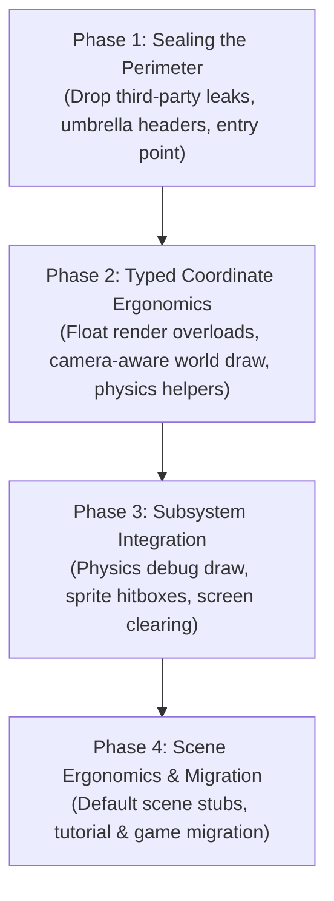

# Roadmap: Ergonomic & Holistic Neutrino Engine

> **Mission**: Transform Neutrino from a collection of loosely coupled helper libraries (`sdlpp`, `euler`, `musac`, raw SDL) into a unified, ergonomic, and holistic 2D game engine. Game developers building with Neutrino should only need `#include <neutrino/neutrino.hh>` and should never have to manually convert between disparate math, color, or input types.

---

## 1. Executive Summary & Problem Diagnosis

Neutrino possesses excellent low-level engine capabilities: deterministic fixed-timestep simulation, continuous swept SAT collision, dynamic AABB broadphase trees, GPU sprite caching with atlas packing, and multi-channel audio streaming.

However, client code currently feels glued together because the seams of underlying libraries leak across the public boundary:

```
┌────────────────────────────────────────────────────────────────────────┐
│                          Current Client Code                           │
└────────┬───────────────────┬───────────────────┬───────────────────────┘
         │                   │                   │
         ▼                   ▼                   ▼
    sdlpp types         euler types         neutrino types
  • sdlpp::color      • euler::vec2       • world_pos / render_pos
  • sdlpp::scancode   • physics::aabb     • draw_* free functions
  • sdlpp::event      • method accessors  • base_scene lifecycle
  • SDLPP_MAIN          (.x(), .y())      • member accessors (.x, .y)
```

### Specific Friction Points

1. **The Math & Geometry Fragmentation**:
   * **Screen space**: `neutrino::point`, `rect`, `circle` (aliases of `sdlpp::point<int>`, member access `.x`, `.y`).
   * **World space**: `neutrino::world_point`, `world_rect` (aliases of `sdlpp::point<float>`).
   * **Physics geometry**: `neutrino::physics::vec` (`euler::vec2<float>`, method access `.x()`, `.y()`), `physics::aabb` (min/max vec), `physics::circle`.
   * **Strong coordinate types**: `world_pos`, `world_delta`, `world_velocity` in `coordinates.hh`.
   * *Impact*: Passing an actor's position to drawing requires `static_cast<int>` or explicit `to_world_point()`. Physics shapes cannot be debug-rendered without manually destructuring each shape into primitive draw calls.

2. **Leaky Dependencies in Public API**:
   * Colors require `#include <sdlpp/video/color.hh>` and `sdlpp::color{...}` or `sdlpp::colors::black`.
   * Input queries require `#include <sdlpp/events/keyboard_codes.hh>` and `in.pressed(hotkey{sdlpp::scancode::escape})`.
   * Application startup requires `#include <sdlpp/app/entry_point.hh>` and the `SDLPP_MAIN` macro.
   * Event handling forces every `base_scene` to implement pure virtual `handle_action(const sdlpp::event&)`.
   * Drawing calls return `sdlpp::expected<void, std::string>`, a result no caller checks (0 of 147 call sites in games, demos, examples and tutorials) and that also leaks the `sdlpp::` spelling.

3. **Subsystem Islands**:
   * Physics and visual sprites are disconnected. Visual frames authored in `sprite_def_builder` cannot declare hitboxes, and physics colliders have no built-in visual debug rendering.
   * Screen clearing has no native function (`neutrino::clear(...)` is missing, forcing users to call `get_renderer().clear()`).

4. **Header Sprawl**:
   * Writing a basic scene in `tutorials/01_window_and_scene` requires **7 separate `#include`s** across both `neutrino` and `sdlpp`.

---

## 2. Design Principles

1. **Zero Mandatory Dependency Leakage**: Client code should never need to include `<sdlpp/...>` or `<euler/...>` for standard gameplay, graphics, input, or audio.
2. **One Front Door**: `#include <neutrino/neutrino.hh>` gives you everything needed to build a 2D game.
3. **Float-First Gameplay & Graphics**: Gameplay math lives in floating-point world units. Drawing functions accept float render-space positions natively, rounding to pixels only at the final submission boundary; world positions are drawn through a camera.
4. **Explicit Space Crossings, Native Floats**: Same-space calls accept floats directly; crossings between world, render and physics spaces stay explicit (camera or named helper), never implicit conversions.
5. **Integrated Subsystems**: Physics, sprites, and rendering must cross-connect: built-in debug drawing for colliders, hitbox definitions in sprite defs, and scene-level audio/transition helpers.

---

## 3. Phased Roadmap



---

### Phase 1: Sealing the Perimeter (Quick Wins, High Impact)

**Goal**: Eradicate all mandatory `sdlpp` headers and syntax from client game code.

#### 1.1 First-Class Engine Colors (`neutrino::color`)
* **Location**: `<neutrino/video/color.hh>` (and re-exported by `<neutrino/neutrino.hh>`).
* **Implementation**: aliases, per the P1.7 decision (engine-owned *names*, not new types):
  ```cpp
  namespace neutrino {
      using color = sdlpp::color;
      using fcolor = sdlpp::fcolor;
      namespace colors = sdlpp::colors;   // the full named palette, not a hand-picked subset
  }
  ```
  A namespace alias keeps every named colour clients already use (`forest_green`, `coral`, `crimson`, ...); a hand-copied subset would have broken them.
* **Client Impact**: Clients write `neutrino::colors::white` and `neutrino::color{r, g, b, a}` without including `sdlpp/video/color.hh`. Public neutrino headers use the same spelling.

#### 1.2 Native Input Enums & Fluent Queries
* **Location**: `<neutrino/input/keys.hh>` and `<neutrino/input/input_snapshot.hh>`.
* **Implementation**:
  * Provide `neutrino::key` (aliasing `sdlpp::scancode` for physical layout-independent keys), `neutrino::keycode`, `neutrino::mouse_button`, `neutrino::gamepad_button` and `neutrino::gamepad_axis` -- aliases, per P1.7.
  * Add direct convenience queries on `input_snapshot`:
    ```cpp
    // Direct key queries without wrapping in hotkey{}
    [[nodiscard]] bool key_pressed(key k) const noexcept;
    [[nodiscard]] bool key_held(key k) const noexcept;
    [[nodiscard]] bool key_released(key k) const noexcept;

    // Overloaded pressed/held/released
    [[nodiscard]] bool pressed(key k) const noexcept { return key_pressed(k); }
    [[nodiscard]] bool held(key k) const noexcept { return key_held(k); }
    [[nodiscard]] bool released(key k) const noexcept { return key_released(k); }

    // Direct mouse queries
    [[nodiscard]] bool mouse_pressed(mouse_button b) const noexcept;
    [[nodiscard]] bool mouse_held(mouse_button b) const noexcept;
    [[nodiscard]] bool mouse_down(mouse_button b) const noexcept { return mouse_held(b); }
    [[nodiscard]] render_pos mouse_pos() const noexcept { return pointer().render; }
    ```
* **Client Impact**:
  * Old: `in.pressed(neutrino::hotkey{sdlpp::scancode::escape})`
  * New: `in.pressed(neutrino::key::escape)` or `in.key_pressed(key::escape)`

#### 1.3 Engine Entry Point Macro (`NEUTRINO_MAIN`)
* **Location**: `<neutrino/entry_point.hh>`.
* **Implementation**:
  ```cpp
  #pragma once
  #include <sdlpp/app/entry_point.hh>

  #define NEUTRINO_MAIN(AppClass) SDLPP_MAIN(AppClass)
  ```
* **Client Impact**: Tutorial and game entry files include `<neutrino/entry_point.hh>` and invoke `NEUTRINO_MAIN(MyGame)`. No mention of `sdlpp`.

#### 1.4 Default Stubs in `base_scene`
* Make `handle_action` and `is_opaque` non-pure with sensible defaults (ignore raw events; opaque). Details in §4.1.

#### 1.5 The Umbrella "Front Door" (`<neutrino/neutrino.hh>`)
* **Location**: `include/neutrino/neutrino.hh`.
* **Contents**:
  * Core application: `<neutrino/application.hh>`, `<neutrino/scene/base_scene.hh>`, `<neutrino/scene/scene_transitions.hh>`
  * Geometry & types: `<neutrino/video/geometry_types.hh>`, `<neutrino/video/color.hh>`, `<neutrino/coordinates.hh>`
  * Graphics & sprites: `<neutrino/video/draw.hh>`, `<neutrino/video/sprites.hh>`, `<neutrino/video/globals.hh>`
  * Input: `<neutrino/input/input_snapshot.hh>`, `<neutrino/input/keys.hh>`
  * Audio: `<neutrino/audio/audio.hh>`
* **Client Impact**: An entire game scene can be written with a single `#include <neutrino/neutrino.hh>`.

#### 1.6 Draw Calls Return `void`
* **Decision**: drawing is fire-and-forget. Draw primitives and `draw_sprite` return `void`; state getters return their value directly. This removes every `expected` from neutrino's public API, so no `neutrino::expected` alias is needed. (An alias was the original plan; it was dropped once it turned out `draw.hh` is the only public header that returns `expected`.)
* **Why `expected` buys nothing here**:
  * **No caller uses it.** 0 of 147 draw calls in games, demos, examples and tutorials look at the result. The only consumers are three engine-internal call sites in `world_renderer.cc` that bump `stats.failed`, which tests assert is 0 and `map_viewer` prints.
  * **Programmer errors never reach it.** A bad scale or rotation already fails `ENFORCE`; an invalid sprite reference or empty destination is a silent no-op.
  * **What remains is SDL's own return value** from `SDL_RenderLine`, `SDL_RenderFillRect`, `SDL_RenderGeometry`, etc. In SDL3 these fail only on a broken renderer, a texture from another renderer, or out-of-memory while queuing. None of these can be handled per call, mid-frame.
  * **It is unenforced.** The `void`-valued draws aren't `[[nodiscard]]`, so results are silently dropped; adding `[[nodiscard]]` would only spread `(void)` casts across 147 call sites.
  * **Getters wrap engine-owned state.** `get_draw_color()`, `get_draw_blend_mode()` and `get_line_style()` return `expected` for state the engine itself set.
* **New contract** (`include/neutrino/video/draw.hh`):
  ```cpp
  NEUTRINO_EXPORT void draw_line(const point& a, const point& b, const color& c);
  NEUTRINO_EXPORT void draw_sprite(const point& position, sprite_state_id state,
                                   const sprite_draw_params& params = {});
  NEUTRINO_EXPORT void set_draw_color(const color& c);
  NEUTRINO_EXPORT [[nodiscard]] color get_draw_color();
  ```
* **Failures stay visible, not silent**: when SDL reports an error, the engine logs it, rate-limited per call site (the 1st, 1001st, ... failure of each `DRAW_CHECK` site, logged with that site's line), and increments `draw_failure_count()`, a running total since startup. Tests and tools compare the count before and after a span of draws; `world_renderer`'s `stats.failed` does exactly that per tile. (Per-call-site limiting and a running total replaced the earlier "first failure per frame" / per-frame counter idea: neither needs a frame-start reset hook in `draw.cc`.)
* **Scope of `expected` vs. other error channels** (unchanged, now documented as policy):
  * Draw calls: `void` + log/counter (this item).
  * Loading images: throws (`image_loader.hh`); a missing asset is fatal for the caller.
  * Optional resources: `std::optional` (`render_texture::create`).
  * If a future public API has a failure the caller can genuinely act on, introduce `<neutrino/expected.hh>` (aliasing `failsafe::expected`) at that point, not before.
* **Client impact**: none for normal code. A call written as a statement compiles unchanged when its return type becomes `void`; only code that inspects the result (`.has_value()`, `return draw_...(...)`) must change, and none exists outside `world_renderer.cc`. Phase 2's float `render_pos` overloads (§2.1) are specified as `void` already and stay that way.

#### 1.7 Seal sdlpp Out of the Client-Facing API
* **Goal (option A)**: client code never needs to *spell* `sdlpp`. sdlpp stays compiled in and reachable through transitive includes; what is sealed is the documented API and its spelling, enforced by a check. Making sdlpp unreachable (wrapper types, no sdlpp in any public header) was considered and rejected: it is a large rewrite with conversion cost at every boundary, for a library we own.
* **Baseline** (2026-10-26): client code (games, demos, examples, tutorials) names `sdlpp::` ~600 times (~450 keys, ~120 colours, window flags, low-level video) and 18 client files include `<sdlpp/...>`; the website teaches the same spellings; neutrino's public headers name sdlpp ~180 times.
* **1. Vocabulary aliases** (engine-owned names, not new types -- these are SDL-shaped value types, so wrapping them would only add conversions):
  * `color`, `fcolor`, `colors` (P1.1); `key`, `keycode`, `mouse_button`, `gamepad_button`, `gamepad_axis` (P1.2)
  * `blend_mode`, `line_style`, `event`, and `image` (= `sdlpp::surface`, for `image_loader.hh` and the sprite-atlas constructors)
  * `window_flags` is already aliased; only its users need migrating.
  * Public neutrino headers are then rewritten in these names, so docs and IDE tooltips show neutrino types.
* **2. `application` inherits `sdlpp::game_application` privately.**
  * Drop the nine `using sdlpp::game_application::...` re-exports. The raw mouse/key getters are superseded by `input_snapshot`; fullscreen gets neutrino methods.
  * `render_scene(sdlpp::renderer&)` becomes `render_scene()` (there is one renderer).
  * Private inheritance makes the derived-to-base conversion inaccessible outside the class, which `SDLPP_MAIN` and the test harnesses rely on (`static_cast<sdlpp::abstract_application*>(&app)`). So `NEUTRINO_MAIN` gets its own expansion that reaches the base through a friend accessor (`neutrino::detail::application_access`), the pattern `simplex/entry_point.hh` already uses; the harnesses switch to it.
* **3. Raw SDL access stays where it is.** `get_renderer()` / `get_window()` remain in `globals.hh`: calling them does not make a client spell `sdlpp`, so a separate interop header would buy nothing under option A. They are documented as the escape hatch (they bypass `pixel_snap`, `DRAW_CHECK` and `draw_failure_count()`) and carry a marker the guard accepts.
* **4. Guard** (CTest, CMake script, no extra dependencies): flags `sdlpp::` / `<sdlpp/` in public headers (except marked lines and `detail/`), tutorials, examples and website snippets. `demos/` and `games/` are allowlisted (the VGA canvas and KE asset loading are genuine low-level code). Starts **warning-only**, reporting the remaining count, and flips to failing once the migration lands.
* **5. Migration**: move clients and docs off `sdlpp::` (mostly mechanical: keys and colours), then flip the guard to fail.
* **As implemented** (refinements found while doing it):
  * The gamepad enums are `pad_button` / `pad_axis`: `gamepad_button` was already the per-slot button matcher class (as `key` feeds `hotkey` and `mouse_button` feeds `mouse_click`).
  * `renderer`, `window` and `texture` got aliases too (in `globals.hh`), so `get_renderer()` / `get_window()` need no guard marker: the only `sdlpp-ok` lines are alias definitions and the entry-point plumbing. Added `fpoint` (untyped float point) for the window/render coordinate mapping and camera parallax.
  * Members of the private base that are engine API are re-exported by the base's injected name, so the header spells no `sdlpp::`: `quit`, `is_running`, the fullscreen trio (public), and `get_renderer` / `get_window` (protected -- otherwise an unqualified `get_renderer()` inside an application subclass finds the private base member by class-scope lookup and fails access checking instead of reaching the free function).
  * `get_window_config()` became private `final` plumbing: `map_viewer` overrode it only to restate `application_config` fields and now uses `application(cfg)`.
  * Every client entry point moved from `SDLPP_MAIN` to `NEUTRINO_MAIN` (required: `SDLPP_MAIN` cannot convert to the private base). `map_viewer`'s wheel zoom moved from `handle_action` + `mouse_wheel_event` to the snapshot (`in.wheel()`, `in.pointer().render`); `sprite_demo` loads through `neutrino::load_image()`.
  * Result: 459 flagged lines -> 0; the `sdlpp_seal` CTest runs in fail mode. `games/` and `demos/` still spell sdlpp in places (allowlisted).

---

### Phase 2: Typed Coordinate Ergonomics

**Goal**: Remove the casting noise at the draw and physics boundaries *without* collapsing the strong coordinate vocabulary. `coordinates.hh` deliberately separates `world_pos` / `world_delta` / `world_velocity`, and `render_pos` / `window_pos` exist so that mixing spaces is a compile error. Phase 2 keeps that: every crossing between spaces stays explicit, but becomes short, and every same-space call accepts floats natively.

> **Rejected: a universal `vec2<T>` adapter (former Option A).** A struct cannot declare both a data member `x` and a member function `x()`, so the "dual accessor" design does not compile. Bidirectional implicit conversions between `vec2`, `euler::vector`, `euler::point2` and `sdlpp::point` cause overload ambiguity in the existing `draw_*` sets, and re-aliasing `point` / `rect` breaks every sdlpp API taking `sdlpp::point<int>`. Most importantly, an implicit `world_pos → vec2f` conversion plus a `draw_sprite(world_pos)` overload would silently treat world coordinates as render coordinates (no camera applied) -- exactly the bug class the strong types were introduced to prevent. The measured friction is small (KE has 7 `to_world_point` calls, all feeding `sprite_batch::add`), so it is fixed at those boundaries instead.

#### 2.1 Float Render-Space Drawing
* **Location**: `<neutrino/video/draw.hh>`, `src/neutrino/video/draw.cc`, presentation config.
* **Decision**: draw in floats end to end. SDL3 draws in floats natively (`SDL_RenderPoint`, `SDL_RenderLine`, `SDL_RenderRect` / `SDL_RenderFillRect`, `SDL_RenderTexture` all take `float`), and sdlpp's `int` overloads only `static_cast<float>` into the same calls. Rounding a float to `int` before submission would just be converted straight back to float, losing precision for nothing. Under a scaled presentation (e.g. 640x360 logical in a 1920x1080 window) the fractional part is visible: it gives smooth sub-pixel motion and zoom instead of 3-physical-pixel steps.
* Add float **render-space** overloads of the immediate-mode primitives and `draw_sprite`:
  ```cpp
  // render_pos already exists in coordinates.hh: "what scenes draw in".
  void draw_point(render_pos p, const color& c);
  void draw_line(render_pos a, render_pos b, const color& c);
  void draw_rect(const render_rect& r, const color& c);       // render_rect: float {x, y, w, h}
  void draw_rect_fill(const render_rect& r, const color& c);
  void draw_circle(render_pos centre, float radius, const color& c);
  void draw_circle_fill(render_pos centre, float radius, const color& c);

  void draw_sprite(render_pos position, sprite_state_id state, const sprite_draw_params& params = {});
  void draw_sprite(render_pos position, sprite_visual_ref visual, const sprite_draw_params& params = {});
  void draw_sprite(render_pos position, const sprite_appearance& a, const sprite_draw_params& params = {});
  ```
* **Every primitive, including the line variants.** As implemented, `draw_line_aa`, `draw_line_thick`, `draw_line_dashed`, `draw_line_dotted`, `draw_arrow` and `draw_cross` got `render_pos` overloads too: the demos drew anti-aliased lines from float projections and had to truncate them to `int` first, which defeats the anti-aliasing.
* **One implementation, in float.** Each primitive is implemented once on floats; the existing `int` / `point` overloads become one-line forwards to it (`int` -> `float` is exact below 2^24). This mirrors how sdlpp itself is layered. Integer overloads remain; nothing is removed.
* **Optional pixel snapping, as a policy.** Integer-scaled pixel art (KE) wants positions on whole logical pixels: a sprite at a fractional position with nearest-neighbour sampling shows uneven pixel widths ("pixel crawl") while moving slowly, and can differ between GPU backends. So snapping is a single presentation-level setting, applied in the one submit helper shared by all overloads -- not hard-coded:
  ```cpp
  enum class pixel_snap { off, logical };   // off (default): faithful floats; logical: round to whole logical pixels
  ```
  KE opts into `pixel_snap::logical`; everything else draws faithful floats. Game code never writes `static_cast<int>(x)` either way.
* **Sprites**: `copy_ex` takes float rectangles, and the diagonal-flip / rotation path already builds float vertices for `render_geometry`. The float path therefore computes origin and size as `w * scale` directly instead of rounding through `scaled_offset` / `scaled_extent`. The `draw_sprite(const rect& dst, ...)` overload with an explicit integer destination stays unchanged: `world_renderer` derives that destination from two rounded world corners to keep tiles seam-free under fractional zoom. That is a tile-map decision, separate from the draw API's precision.
  * *Visible change*: with a fractional `scale` (e.g. a zoomed map viewer), sprites drawn at integer positions are no longer rounded to whole-pixel sizes/origins under `pixel_snap::off`. `pixel_snap::logical` must keep rounding them, so pixel-art output stays identical.
* **Circles are the exception.** sdlpp's `draw_circle` / `fill_circle` are `int`-only midpoint rasterizers, so the float overloads round centre and radius internally (documented). Build float circles from `render_geometry` (a triangle fan, as sdlpp's `fill_polygon` does) only if a client needs sub-pixel circles.
* **Brace-init must stay unambiguous**: if `draw_point({1, 2})` can build both a `point` and a `render_pos`, the call is ambiguous. Add a compile test pinning which overload `draw_*({x, y}, ...)` selects; prefer `render_pos{...}` in docs for new code over a second untyped float point.
* **Tests**: existing pixel-readback tests draw at integer coordinates, which are exact in float, so they are unaffected. Add coverage for a fractional position with `pixel_snap::off` vs `pixel_snap::logical`.

#### 2.2 Camera-Aware World Drawing
* World positions reach the screen only through a camera. Provide that path explicitly instead of an implicit conversion:
  ```cpp
  // <neutrino/video/world/camera.hh>
  [[nodiscard]] render_pos to_render(const camera& cam, dim viewport, world_pos p) noexcept;

  // <neutrino/video/world/sprite_batch.hh> -- the call site behind every KE to_world_point()
  // world_pos mirror of each existing add(world_point, ...) overload, e.g.:
  void add(world_pos pos, draw_layer layer, float depth, sprite_state_id state, sprite_draw_params params = {});
  ```
* `sprite_batch::add(world_pos, ...)` removes all current `to_world_point()` calls in `games/ke/scenes/play_game_scene.cc`.
* The existing `to_world_point()` / `to_world_pos()` helpers stay as the explicit escape hatch; there is **no** implicit `world_pos ↔ world_point` conversion and **no** `draw_*(world_pos)` overload without a camera.

#### 2.3 Physics Boundary Conversions
* `physics::vec` stays `euler::vec2f` internally; the physics `world` API already speaks `world_pos` (`move_to`, `position_of`).
* For the remaining shape-construction sites (e.g. KE `mechanics.cc` building `aabb` / `circle` from floats and `world_velocity`), add named, constexpr helpers in `<neutrino/physics/geometry/types.hh>`:
  ```cpp
  [[nodiscard]] constexpr vec to_vec(world_pos p) noexcept;
  [[nodiscard]] constexpr vec to_vec(world_delta d) noexcept;
  [[nodiscard]] constexpr vec to_vec(world_velocity v) noexcept;
  [[nodiscard]] constexpr world_pos to_world_pos(vec v) noexcept;
  [[nodiscard]] constexpr aabb to_aabb(world_bounds b) noexcept;
  ```
* No change to `.x()` vs `.x` access: physics internals keep euler syntax, gameplay code keeps the strong types, and the two meet only through these helpers.

---

### Phase 3: Subsystem Integration (Bridging the Islands)

**Goal**: Connect graphics, physics, and screen management into a cohesive ecosystem.

#### 3.1 First-Class Screen & Canvas Operations
* Add global screen operations to `draw.hh` / `globals.hh`:
  ```cpp
  /// @brief Clear the active render target / screen with color (defaults to black).
  void clear(const color& c = colors::black);

  /// @brief Clear the screen with a specific background color and reset the viewport.
  void clear_screen(const color& c);
  ```
* Automatically works whether rendering to the window, an offscreen `render_texture`, or a `simplex::application` canvas.

#### 3.2 Physics Debug Rendering
* **Location**: `<neutrino/physics/debug_draw.hh>`.
* **API**:
  ```cpp
  namespace neutrino::physics {
      /// Draw an individual collision shape (AABB, circle, segment, triangle)
      void debug_draw(const aabb& box, const color& c = colors::green);
      void debug_draw(const circle& circ, const color& c = colors::green);
      void debug_draw(const segment& seg, const color& c = colors::green);
      void debug_draw(const triangle& tri, const color& c = colors::green);
      void debug_draw(const shape_t& shape, const color& c = colors::green);

      /// Draw all active colliders, sensors, and velocities in the physics world
      void debug_draw(const world& phys_world, const camera& cam,
                      const debug_draw_options& options = {});
  }
  ```
* **Impact**: Eliminates hundreds of lines of bespoke collider-visualization code across user games and tests.

#### 3.3 Authoring Colliders on Visual Sprites
* Allow defining frame hitboxes directly inside `sprite_def_builder`:
  ```cpp
  auto def = sprite_def_builder{}
      .from_file("player.png", 320, 240)
      .add_visual("player.idle", rect{0, 0, 32, 32}, point{16, 32})
      .add_collider("player.idle", aabb{ {-10.0f, -32.0f}, {10.0f, 0.0f} }) // relative to pivot!
      .build();
  ```
* Expose `sprite_metrics::collider()` so games can automatically configure physics bodies from sprite metadata.

#### 3.4 First-Class Textures (`neutrino::texture`)
* **Problem**: neutrino has no first-class texture. Textures exist only as hidden sprite-atlas storage (`texture_registry`) or as `render_texture` (target-only, `compose()` + `blit()` only). Everything else falls to raw SDL and loses what `draw.hh` adds (`pixel_snap`, `DRAW_CHECK` / `draw_failure_count()`, render-space types). `texture_layer.hh` even documents that the game "owns and updates" a streaming texture -- i.e. creates it through raw SDL. brix (planned port) uses five texture patterns, none expressible today: static image textures drawn by sub-rect with flip (backdrops, wallpapers, tileset and font atlases), a render target bound across begin/end and then used as a source, screen read-back into a texture, palette framebuffers streamed every frame, and textured quads (`SDL_RenderGeometry`) for rotation effects.
* **Decisions** (2026-10-26):
  * **One type with an access mode**, not three types:
    ```cpp
    enum class texture_access : std::uint8_t { fixed, streaming, target };

    class texture {   // move-only RAII; replaces the P1.7 alias of sdlpp::texture
      public:
        static std::optional<texture> from_image(const image& img);              // fixed
        static std::optional<texture> create(dim size, texture_access access,
                                             pixel_format fmt = pixel_format::RGBA8888);
        dim size() const noexcept;  texture_access access() const noexcept;
        void set_scale_mode(scale_mode m);    // nearest (pixel art) / linear
        void set_blend_mode(blend_mode m);

        // streaming only (ENFORCE otherwise)
        void update(std::span<const std::uint32_t> pixels);                     // whole texture
        [[nodiscard]] pixel_lock lock();                                       // RAII write view

        // target only (ENFORCE otherwise)
        template<class Fn> void compose(Fn&& draw, std::optional<color> clear = colors::transparent);
        [[nodiscard]] target_scope bind(std::optional<color> clear = {});      // begin/end flows
        [[nodiscard]] image to_image() const;                                   // read-back

        const sdlpp::texture& native() const noexcept;                           // escape hatch
    };
    ```
    `std::nullopt` as the clear colour composes onto the existing contents (persistent canvases).
  * **One way to draw any texture**, in `draw.hh`, with the same contract as the rest of it (float render space, `pixel_snap`, `DRAW_CHECK`):
    ```cpp
    struct texture_draw_params { std::optional<rect> src; sprite_flip flip{}; float rotation_degrees{};
                                 std::optional<render_pos> pivot; color tint{colors::white}; };
    void draw_texture(const texture& t, const render_rect& dst, const texture_draw_params& p = {});
    void draw_texture(const texture& t);                                   // fill the current target
    void draw_texture_quad(const texture& t, const std::array<render_pos, 4>& corners,
                           std::optional<rect> src = {});                  // rotor-style mapping
    [[nodiscard]] image capture_frame();   // read the current target; valid before present only
    ```
  * `get_renderer()` / `get_window()` stay public as the escape hatch; with this in place a game should rarely need them.
* **Migration -- every site found in the review** (2026-10-26):
  * Engine:
    * `render_texture` (`include/neutrino/video/render_texture.hh`, `src/.../render_texture.cc`) becomes `texture` with `texture_access::target`; `compose()` moves out of line (it calls `get_renderer()` in the header today). `render_texture` is removed.
    * `texture_registry` / `gpu_texture_atlas` (`src/neutrino/video/sprite/texture_registry.*`): sprite atlases are backed by `neutrino::texture` (fixed); the sprite draw paths in `draw.cc` (`copy_ex`, `render_geometry`) read it through `native()`. Its `create(format, access, w, h)` overload is the seed of `texture::create`.
    * `texture_layer` (`include/neutrino/video/world/texture_layer.hh`): holds a `const neutrino::texture*` and draws it with `draw_texture`; drop the "game creates a streaming texture" note.
    * simplex adapter (`src/neutrino/simplex/detail/application_adapter.cc`): its hand-made target canvas + `target_guard` scope + `copy` become a `texture` (target, nearest, no-clear) + `bind()` + `draw_texture`.
  * Clients:
    * KE `games/ke/assets/backdrop.cc` + `scenes/play_game_scene.cc:221` (`render_texture::create`, `blit`) -> `texture::create(..., target)`, `draw_texture`.
    * KE `games/ke/tests/enemies.cc:172` (`SDL_RenderReadPixels` screenshot) -> `capture_frame()` (+ `image` save).
    * demoscene `demos/demoscene/vga_canvas.cc` (streaming texture + raw `copy`) -> `palette_canvas` (P3.5).
    * `tutorials/drawing/04_render_textures` + `website/docs/tutorial/drawing/04-render-textures.md` + `concepts/drawing.md` §4 -> the texture API.
  * Tests (raw `SDL_CreateTexture` targets + `SDL_RenderReadPixels`): `test/video/test_draw.cc`, `test_window_presentation.cc`, `world/test_world_compositor.cc`, `world/test_world_draw.cc`, `test/simplex/test_entry_point.cc` -> `texture` targets + `to_image()` / `capture_frame()`.
  * brix (future port), for the design check: `video/video_assets.cc` + `video/video_system.cc` (static textures, ~12 sub-rect draws, flip) -> `texture::from_image` + `draw_texture`; `game/view/game_board_painter.cc` (target begin/end, `get_texture()`) -> `bind()`; `game/view/view.cc:177` (read screen back to rotate it) -> rotate the board target directly with `draw_texture_quad`; `game/view/rotor.cc` (textured `SDL_RenderGeometry`) -> `draw_texture_quad`; `libs/gfx/*framebuffer*` -> `palette_canvas`.

#### 3.5 Palette Canvas (`neutrino::palette_canvas`)
* **Why in the engine**: brix's `libs/gfx` (static/dynamic framebuffers: 8-bit indexed buffer, 256-colour palette, fades, blur) and the demoscene `vga_canvas` (indexed buffer, 6-bit DAC palette, palette cycling) are two independent copies of the same machine.
* **Shape**: an indexed `std::vector<std::uint8_t>` buffer plus a 256-entry `color` palette, uploaded through a streaming `texture` once per frame (palette lookup on upload), drawn with `draw_texture`. Palette ops: `set_color`, 6-bit DAC helpers, `cycle(start, count, step)`, `fade_in/out(step, steps)`. Pixel ops: `put_pixel`, `get_pixel`, h/v lines, `clear`, `fill`, raw `pixels()` span; effect helpers (brix's blur) come over with the port.
* **Builds on** P3.4 (`texture_access::streaming`). Migrates `demos/demoscene/vga_canvas` first, then brix `libs/gfx`.

---

### Phase 4: Scene Ergonomics & Migration

**Goal**: Remove unnecessary ceremony and migrate all tutorials, games, and tests.

#### 4.1 Streamlining `base_scene`
* Provide default implementations for pure virtual stubs:
  ```cpp
  class base_scene {
  public:
      virtual ~base_scene() = default;

      // Pure virtual hooks that scenes MUST implement:
      virtual void fixed_update(sim_duration dt, const input_snapshot& in) = 0;
      virtual void render() = 0;

      // Sensible defaults (no longer pure virtual):
      virtual void handle_action(const sdlpp::event&) {} // Default: ignore raw SDL events
      [[nodiscard]] virtual bool is_opaque() const { return true; } // Default: opaque
  };
  ```
* Provide scene-level convenience methods:
  ```cpp
  void pop_this_scene();
  void push_next_scene(std::unique_ptr<base_scene> scene);
  dim scene_render_size() const;
  ```

#### 4.2 Migration of Tutorials and Games
1. Update `tutorials/01_window_and_scene`:
   * Replace 7 `#include`s with `#include <neutrino/neutrino.hh>`.
   * Replace `SDLPP_MAIN` with `NEUTRINO_MAIN`.
   * Delete empty `handle_action` stub.
   * Use `neutrino::colors::*` and `in.pressed(key::escape)`.
2. Update `tutorials/02_one_sprite`:
   * Remove `static_cast<int>(m_player_x)` from `draw_sprite`.
   * Pass float coordinates directly.
3. Update `games/ke` (`krypton_egg`):
   * Replace `to_world_point()` calls with `sprite_batch::add(world_pos, ...)`.
   * Adopt `neutrino::clear(...)` and direct physics debug drawing.

---

## 4. Work Breakdown & Effort Matrix

| Phase | Task | Effort | Files Affected | Breaking Change? |
| :--- | :--- | :---: | :--- | :---: |
| **P1.1** | `neutrino::color` & `colors::*` | **S** (½ day) | `include/neutrino/video/color.hh`, `draw.hh` | No (type alias) |
| **P1.2** | `key::*` enum & fluent `input_snapshot` queries | **S** (½ day) | `include/neutrino/input/keys.hh`, `input_snapshot.hh` | No (additive) |
| **P1.3** | `NEUTRINO_MAIN` macro | **S** (1 hr) | `include/neutrino/entry_point.hh` | No (additive) |
| **P1.4** | Default stubs in `base_scene` | **S** (1 hr) | `include/neutrino/scene/base_scene.hh` | No (additive) |
| **P1.5** | Umbrella header `<neutrino/neutrino.hh>` | **S** (2 hrs) | `include/neutrino/neutrino.hh` | No (additive) |
| **P1.6** | Draw calls return `void`; getters return values; failures logged + counted | **S** (½ day) | `include/neutrino/video/draw.hh`, `src/neutrino/video/draw.cc`, `video/world/world_renderer.*` | No for callers that ignore results (all client code) |
| **P1.7** | Seal sdlpp out of the client-facing API: vocabulary aliases, private `application` inheritance + own `NEUTRINO_MAIN`, guard (warn → fail), migration | **M+** (1-2 days) | `include/neutrino/**`, `src/neutrino/application.cc`, `entry_point.hh`, `test/`, clients, docs | No for clients (aliases name the same types); yes for code calling the dropped `application` re-exports / `render_scene(renderer&)` |
| **P2.1** | Float render-space drawing: float `render_pos` overloads, int overloads forward to float, optional `pixel_snap` policy | **M+** (1-2 days) | `include/neutrino/video/draw.hh`, `src/neutrino/video/draw.cc`, presentation config | No for source (overloads); output changes for sprites with a fractional `scale` (size/origin no longer rounded) |
| **P2.2** | Camera-aware world drawing (`to_render`, `sprite_batch::add(world_pos)`) | **S** (½ day) | `video/world/camera.hh`, `video/world/sprite_batch.hh` | No (additive) |
| **P2.3** | Physics boundary helpers (`to_vec`, `to_aabb`) | **S** (2 hrs) | `include/neutrino/physics/geometry/types.hh` | No (additive) |
| **P3.1** | Screen clear functions (`neutrino::clear`) | **S** (2 hrs) | `include/neutrino/video/draw.hh`, `globals.hh` | No (additive) |
| **P3.2** | Physics debug renderer | **M** (2 days) | `include/neutrino/physics/debug_draw.hh`, `src/...` | No (additive) |
| **P3.3** | Sprite def hitbox integration | **M** (2 days) | `sprite_def_builder.hh`, `sprite_sheet.hh` | No (additive) |
| **P3.4** | First-class `texture` (one type, `fixed`/`streaming`/`target` access) + `draw_texture` / `draw_texture_quad` / `capture_frame`; migrate `render_texture`, sprite atlases, `texture_layer`, simplex canvas, KE, tests | **L** (3-4 days) | `video/texture.hh` (new), `draw.hh`, `render_texture.*` (removed), `sprite/texture_registry.*`, `world/texture_layer.hh`, simplex adapter, KE, tests, docs | Yes: `render_texture` is replaced by `texture`; the P1.7 `texture` alias becomes the engine class |
| **P3.5** | `palette_canvas` (8-bit indexed + palette, fades/cycling) on a streaming `texture`; migrate demoscene `vga_canvas` | **M** (1-2 days) | `video/palette_canvas.hh` (new), `demos/demoscene` | No (additive) |
| **P4.1** | Migrate tutorials 01–03 & simplex | **S** (½ day) | `tutorials/*` | No |
| **P4.2** | Migrate `games/ke` and demos | **M** (1 day) | `games/ke/*`, `demos/*` | No |

*Total Estimated Effort*: ~1.5 to 2 weeks of focused implementation.

---

## 5. Verification & Testing Strategy

1. **Unit Testing**:
   * Test float draw overloads round once at submission, and that `draw_sprite({x, y}, ...)` brace-init resolves unambiguously.
   * Static-assert that `world_pos` does **not** implicitly convert to `world_point`, `render_pos` or `physics::vec`.
   * Test `input_snapshot` fluent methods against synthetic input events.
   * Test `neutrino::clear(color)` on both window renderer and offscreen `render_texture`.
2. **Headless & Display Regression Testing**:
   * Ensure `cmake-build-release/bin/neutrino_tests` (623 cases / 293,523 assertions) remains 100% green at every step.
   * Verify all existing games (`games/ke`, `games/luxor`) compile and run without regression.
3. **Ergonomic Audit ("The Blank File Test")**:
   * Create a new test tutorial file from scratch using only `#include <neutrino/neutrino.hh>` and `NEUTRINO_MAIN`.
   * Verify that not a single `sdlpp` or `euler` identifier is required to open a window, update game state, play sound, and render sprites.
