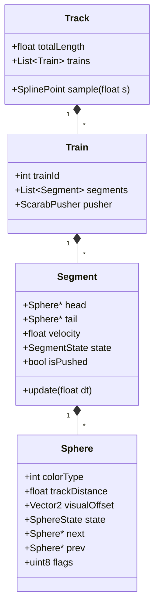

# Luxor Game Engine: Reverse-Engineered Physics & Mechanics Specification

This document provides a complete, mathematically rigorous, and reverse-engineered specification of the sphere physics, chain mechanics, collision algorithms, and game loop of *Luxor* (MumboJumbo). It is derived directly from disassembly and decompilation of `Luxor.exe`, `uigamelevel_physics.cpp`, `gameengine_load.cpp`, level files (`*.lvl`), and path models (`*.obj`).

---

## 1. Core Architecture & Mathematical Foundations

### 1.1 Coordinates and Dimensions
- **Screen Resolution:** $800 \times 600$ pixels.
- **Coordinate System:** 2D screen space with origin $(0, 0)$ at top-left. In 3D path files (LightWave `.obj`), Y is inverted: $y_{\text{screen}} = -y_{\text{3D}}$.
- **Sphere Dimensions:**
  - Radius $R = 16.0\text{ px}$.
  - Contact Diameter $D = 32.0\text{ px}$ (distance between consecutive centers in a train).
  - Scarab Vise Offset: Scarab beetle pusher has collision radius $R_{\text{vise}} = 16.0\text{ px}$ or contact distance $D_{\text{vise}} = 32.0\text{ px}$.

---

### 1.2 Track Geometry: Uniform Cubic B-Spline

Tracks in Luxor are smooth parametric space curves represented by uniform cubic B-splines passing through control points $P_0, P_1, \dots, P_N$.

#### Basis Functions
For a local parameter $t \in [0, 1]$ within span $i$ defined by control points $[P_{i-1}, P_i, P_{i+1}, P_{i+2}]$, the curve position $\mathbf{C}(t)$ is computed using the 4 cubic B-spline basis polynomials:

$$B_0(t) = \frac{(1 - t)^3}{6}$$

$$B_1(t) = \frac{3t^3 - 6t^2 + 4}{6}$$

$$B_2(t) = \frac{-3t^3 + 3t^2 + 3t + 1}{6}$$

$$B_3(t) = \frac{t^3}{6}$$

$$\mathbf{C}(t) = B_0(t) P_{i-1} + B_1(t) P_i + B_2(t) P_{i+1} + B_3(t) P_{i+2}$$

#### Arc-Length Parameterization
To ensure constant physical speed regardless of spline knot spacing, the engine precomputes an arc-length table:
- Spline segments are subdivided into fine step intervals.
- The Euclidean length $\Delta s = \|\mathbf{C}(t + \Delta t) - \mathbf{C}(t)\|$ is accumulated into a monotonic distance table $S[k]$.
- **Lookup Functions:**
  - Given arc length $s \in [0, L_{\text{track}}]$, binary-search or table index gives span index $i$ and local parameter $t$.
  - Position: $\mathbf{P}(s) = (x(s), y(s))$.
  - Tangent Unit Vector: $\mathbf{T}(s) = \frac{d\mathbf{P}}{ds} = (\cos \theta, \sin \theta)$.
  - Normal Unit Vector: $\mathbf{N}(s) = (-\sin \theta, \cos \theta)$.
  - Orientation Angle: $\theta(s) = \text{atan2}(T_y, T_x) \times \frac{180}{\pi}$.
  - Occlusion Flag: Bit 2 of waypoint data indicates occluded/tunnel section (unshootable).

---

## 2. Pusher Scarab ("Vise") Speed Dynamics

The pusher scarab advances forward along the track, pushing the chain of spheres in front of it. Its speed $v(s)$ is a continuous function of its current track distance $s$, governed by level configuration files (`level_*.lvl`).

```
Track Distance: 0 ----------------- midStartDistance ---------------- midEndDistance ---------------- L (Pyramid)
Speed:          viseMaxSpeed --------> viseMidMaxSpeed -------> viseMidMinSpeed --------> viseMinSpeed
Zone:               [ Fast Entry Zone ]           [ Cruising Zone ]             [ Endgame Danger Zone ]
```

### 2.1 3-Segment Piecewise Cubic Bezier Speed Curve
The track is partitioned into 3 distance zones:
1. **Fast Entry Zone:** $s \in [0, s_{\text{midStart}}]$
   - Speed transitions from $v_{\text{max}}$ down to $v_{\text{midMax}}$ (e.g., $800.0\text{ px/s} \to 75.0\text{ px/s}$).
   - Parameter: $u = \frac{s}{s_{\text{midStart}}}$.
   - Control points: `viseSpeedMaxBzLerp` $(k_{1}, k_{2})$, default $(0.9, 0.9)$.
2. **Cruising Zone:** $s \in [s_{\text{midStart}}, s_{\text{midEnd}}]$
   - Speed transitions from $v_{\text{midMax}}$ down to $v_{\text{midMin}}$ (e.g., $75.0\text{ px/s} \to 75.0\text{ px/s}$).
   - Parameter: $u = \frac{s - s_{\text{midStart}}}{s_{\text{midEnd}} - s_{\text{midStart}}}$.
   - Control points: `viseSpeedMidBzLerp` $(k_{1}, k_{2})$, default $(0.25, 0.75)$.
3. **Danger Zone:** $s \in [s_{\text{midEnd}}, L_{\text{track}}]$
   - Speed transitions from $v_{\text{midMin}}$ down to $v_{\text{min}}$ (e.g., $75.0\text{ px/s} \to 3.0\text{ px/s}$).
   - Parameter: $u = \frac{s - s_{\text{midEnd}}}{L_{\text{track}} - s_{\text{midEnd}}}$.
   - Control points: `viseSpeedMinBzLerp` $(k_{1}, k_{2})$, default $(0.25, 0.75)$.

### 2.2 1D Cubic Bezier Formulation
For start speed $V_0$, end speed $V_3$, and control lerp parameters $(k_1, k_2)$:
$$V_1 = V_0 + k_1 \cdot (V_3 - V_0)$$
$$V_2 = V_0 + k_2 \cdot (V_3 - V_0)$$

The evaluated speed at normalized parameter $u \in [0, 1]$ (computed via Horner form in `Luxor.exe` at `0x404515`):
$$v(u) = (1 - u)^3 V_0 + 3(1 - u)^2 u V_1 + 3(1 - u) u^2 V_2 + u^3 V_3$$

---

## 3. Data Structures: Trains, Segments & Spheres



### 3.1 Sphere Definition
A sphere in memory maintains:
- `colorType`: Integer $0 \dots 6$ (colors 1-7), $7$ (Vise/Scarab), $10$ (Wild Ball).
- `trackDistance`: Arc length position $s$ along the track.
- `visualOffset`: Offset vector $(\Delta x, \Delta y)$ for insertion smoothing animation.
- `state`:
  - `0`: Idle / Normal rolling.
  - `1`: Pushed by scarab / leading contact.
  - `2`: Exploding / bursting (burst animation, unlinked from contact physics).
  - `4`: Coasting / decelerating after gap collapse.
  - `5`: Magnetic pull / reverse rolling.
  - `6`: Inserting / sliding into train.
- `next`: Pointer to sphere ahead (closer to pyramid / end of track).
- `prev`: Pointer to sphere behind (closer to scarab pusher / start of track).
- `flags` (`uint8` at offset `0xad`):
  - `0x10`: `GAP_AHEAD` (disconnected from front segment).
  - `0x20`: `GAP_BEHIND` (disconnected from rear segment / attracting).
  - `0x02`: Occluded (in tunnel).
  - `0x08`: Warning / danger zone flag.

---

## 4. Chain Dynamics & Contact Physics

### 4.1 Forward Push Propagation
When the Scarab moves forward by $\Delta s = v(s) \cdot \Delta t$:
1. The Scarab position advances: $s_{\text{scarab}} \leftarrow s_{\text{scarab}} + \Delta s$.
2. For each sphere $i$ in the contiguous segment starting at the scarab:
   $$s_i \leftarrow s_{i-1} + D$$
   where $s_0$ is the sphere directly touching the scarab.
3. Every sphere in the segment maintains rigid contact spacing:
   $$s_{i+1} - s_i = D \quad (D = 32.0\text{ px})$$

### 4.2 Gap Formation on Match
When a group of $M \ge 3$ matching spheres explodes:
1. Matched spheres transition to state `EXPLODING` (`state = 2`).
2. They are unlinked from active physical contact.
3. Boundary spheres update gap flags:
   - The sphere immediately behind the exploded group (`tail_segment->head`) receives flag `0x10` (`GAP_AHEAD`).
   - The sphere immediately ahead of the exploded group (`head_segment->tail`) receives flag `0x20` (`GAP_BEHIND`).
4. **Behavior of Segments:**
   - **Tail Segment (behind gap):** Continues moving forward, driven by the Scarab pusher.
   - **Head Segment (ahead of gap):** Has no pusher behind it. If not subjected to backward magnetic pull, its forward velocity becomes zero:
     $$v_{\text{head}} = 0$$
     It remains completely stationary on the track until pushed from behind or pulled from a forward gap.

---

## 5. Magnetic Pull & Attraction Across Gaps

Attraction occurs across the gap between two segments: the **Head Segment** (ahead) and the **Tail Segment** (behind).

```
[ Tail Segment (Pushed) ]  ---> (Gap) <---  [ Head Segment (Rolling Back) ]
       [Color C]                                  [Color C]
```

### 5.1 Attraction Condition
A gap is magnetic **if and only if**:
$$\text{ColorMatches}(\text{TailSegment}.\text{head}, \text{HeadSegment}.\text{tail}) == \text{true}$$

#### Color Match Function (`0x403050`):
$$\text{ColorMatches}(A, B) = \begin{cases}
\text{false} & \text{if } \text{Color}(A) == 7 \text{ (Vise)} \text{ or } \text{Color}(B) == 7 \\
\text{true} & \text{if } \text{Color}(A) == \text{Color}(B) \\
\text{true} & \text{if } \text{Color}(A) == 10 \text{ (Wild)} \text{ or } \text{Color}(B) == 10 \\
\text{false} & \text{otherwise}
\end{cases}$$

### 5.2 Backward Rolling Physics
When attraction is active:
1. **The Head Segment rolls backward toward the Tail Segment.**
2. **Initial Speed by Combo Level:**
   Let $N$ be the current combo streak ($N \ge 1$):
   $$v_{\text{initial}} = -200.0 \times N \text{ px/s}$$
3. **Acceleration:**
   The head segment accelerates backwards into the gap with constant acceleration:
   $$a_{\text{pull}} = -500.0\text{ px/s}^2$$
   $$v(t + \Delta t) = v(t) + a_{\text{pull}} \cdot \Delta t$$
4. **Speed Clamping:**
   The backward velocity is clamped to maximum reverse speed:
   $$v(t) \ge -1000.0\text{ px/s}$$
5. **Position Update:**
   All spheres in the head segment roll backward together:
   $$s_k(t + \Delta t) = s_k(t) + v(t) \cdot \Delta t$$

---

### 5.3 Gap Collision & Combo Cascades
During backward roll, the distance to the rear segment is evaluated every tick:
$$\text{gap\_distance} = s_{\text{head\_segment\_tail}} - s_{\text{tail\_segment\_head}} - D$$

When $\text{gap\_distance} \le 0$:
1. **Collision Contact:**
   - The head segment snaps to contact distance:
     $$s_{\text{head\_segment\_tail}} = s_{\text{tail\_segment\_head}} + D$$
   - All spheres in the head segment propagate forward positions maintaining spacing $D$.
   - Flags `0x10` and `0x20` are cleared.
   - The two segments are merged into one contiguous doubly linked list.
2. **Combo Match Detection:**
   - Starting at the collision junction, count contiguous spheres matching the junction color forward and backward:
     $$\text{Count} = 1 + N_{\text{ahead}} + N_{\text{behind}}$$
   - If $\text{Count} \ge 3$:
     - **Combo Streak:** $\text{combo} \leftarrow \text{combo} + 1$.
     - **Combo Sound & Pitch Scaling:**
       $$\text{Sound} = \text{collapse\_} \min(\text{Count} - 2, 5)$$
       $$\text{Pitch Multiplier} = 1.0 + (\text{combo} - 1) \times 0.1$$
     - **Reward Logic:**
       - If $\text{Count} \ge 5$: Random roll ($1 / 1000$ check) spawns a falling powerup talisman.
       - If $\text{combo} \pmod 3 == 0$: Spawns a falling coin or gem.
     - The matched spheres enter `state = 2` (explosion burst).
     - **Recursive Cascade:** A new gap is created. If the new gap ends also match, attraction triggers immediately with the escalated combo velocity ($v_{\text{initial}} = -200 \times \text{combo}$).
   - If $\text{Count} < 3$:
     - Backward momentum ceases.
     - Combo streak resets to 0.
     - Inelastic collision: The rear segment pushes the combined chain forward at pusher speed.

---

## 6. Player Shot Collision & Ball Insertion

```
Track Tangent T --->
                      Impact Vector (Sphere - Bullet)
                      \
                       \  DotProduct = T · (Sphere - Bullet)
                        * Sphere
```

### 6.1 Collision Detection
Player shoots a projectile sphere at velocity $v_{\text{shot}} \approx 1200\text{ px/s}$.
- Every physics tick, projectile trajectory line segment is tested against sphere bounding circles:
  $$\|\mathbf{P}_{\text{bullet}} - \mathbf{P}_{\text{sphere}}\| \le R_{\text{bullet}} + R_{\text{sphere}} = 32.0\text{ px}$$
- If occluded by a bridge/tunnel (`isOccluded == true`), collision is ignored.

### 6.2 Insertion Side Determination (Vector Dot Product)
At the point of collision against sphere $K$:
1. Retrieve track tangent vector $\mathbf{T}$ at sphere $K$'s track distance $s_K$.
2. Compute relative impact vector:
   $$\mathbf{V}_{\text{rel}} = \mathbf{P}_{\text{sphere}} - \mathbf{P}_{\text{bullet}}$$
3. Compute 2D dot product:
   $$\text{Dot} = T_x \cdot V_{\text{rel},x} + T_y \cdot V_{\text{rel},y}$$
4. **Decision Rule:**
   - $\text{Dot} \ge 0 \implies$ Impact is on the **forward half** $\to$ Insert **ahead** of sphere $K$ ($K.\text{next}$).
   - $\text{Dot} < 0 \implies$ Impact is on the **rear half** $\to$ Insert **behind** sphere $K$ ($K.\text{prev}$).

### 6.3 Displacement & Smooth Visual Interpolation
1. **List Update:** Insert sphere $J$ into the doubly linked list.
2. **Contact Displacement:**
   - Spheres ahead of the insertion point are pushed forward by $D = 32.0\text{ px}$:
     $$s_m \leftarrow s_m + D \quad (\forall m \text{ ahead of } J)$$
   - If there is an open gap ahead, the displacement is absorbed by the gap without moving subsequent segments.
3. **Visual Smoothing Animation:**
   - The newly inserted sphere does not pop into place.
   - Initial visual offset:
     $$\mathbf{Offset} = \mathbf{P}_{\text{bullet\_impact}} - \mathbf{P}_{\text{track}}(s_J)$$
   - Each frame, $\mathbf{Offset}$ decays toward zero with smoothing:
     $$\mathbf{Offset}_{t+1} = \mathbf{Offset}_t \times (1 - \lambda \cdot \Delta t)$$
     $$\mathbf{RenderPos} = \mathbf{P}_{\text{track}}(s) + \mathbf{Offset}$$

---

## 7. Complete Physics Tick Loop (Pseudocode)

```cpp
void uiGameLevel::UpdatePhysics(float dt) {
    for (Train& train : activeTrains) {
        // Step 1: Update Scarab Pusher
        if (train.hasPusher) {
            float s_vise = train.pusher.trackDistance;
            float v_vise = EvaluateViseSpeedCurve(s_vise);
            train.pusher.trackDistance += v_vise * dt;
        }

        // Step 2: Update Segments from Rear to Front
        for (int i = 0; i < train.segments.size(); ++i) {
            Segment& seg = train.segments[i];

            if (seg.isPushedByScarab) {
                // Forward movement propagated from scarab
                seg.AdvanceForwardFromPusher(train.pusher.trackDistance);
            } else if (seg.state == SEGMENT_ATTRACTING) {
                // Backward roll into gap behind
                seg.velocity += ACCEL_PULL * dt; // -500.0 * dt
                if (seg.velocity < MAX_PULL_SPEED) seg.velocity = MAX_PULL_SPEED; // -1000.0
                seg.AdvanceBackward(seg.velocity * dt);

                // Check collision with segment behind
                Segment& rearSeg = train.segments[i - 1];
                float gap = seg.tail->distance - rearSeg.head->distance - SPHERE_DIAMETER;
                if (gap <= 0.0f) {
                    ResolveGapCollision(rearSeg, seg);
                }
            } else if (seg.state == SEGMENT_COASTING) {
                // Deceleration after failed pull
                seg.velocity += ACCEL_DECEL * dt; // +500.0 * dt
                if (seg.velocity >= 0.0f) {
                    seg.velocity = 0.0f;
                    seg.state = SEGMENT_IDLE;
                }
                seg.AdvanceBackward(seg.velocity * dt);
            }
        }

        // Step 3: Check Gap Attraction Conditions
        for (int i = 1; i < train.segments.size(); ++i) {
            Segment& rearSeg = train.segments[i - 1];
            Segment& leadSeg = train.segments[i];

            if (leadSeg.state == SEGMENT_IDLE) {
                if (ColorMatches(rearSeg.head->color, leadSeg.tail->color)) {
                    leadSeg.state = SEGMENT_ATTRACTING;
                    leadSeg.velocity = -200.0f * (train.comboStreak + 1);
                }
            }
        }

        // Step 4: Resolve Segment-to-Segment Push Collisions
        for (int i = 0; i < (int)train.segments.size() - 1; ++i) {
            Segment& rearSeg = train.segments[i];
            Segment& leadSeg = train.segments[i + 1];

            float dist = leadSeg.tail->distance - rearSeg.head->distance;
            if (dist <= SPHERE_DIAMETER) {
                // Trailing segment pushes leading segment forward
                leadSeg.tail->distance = rearSeg.head->distance + SPHERE_DIAMETER;
                leadSeg.PropagateContactForward();
                MergeSegments(rearSeg, leadSeg);
                --i;
            }
        }

        // Step 5: Check End of Track (Lose Condition)
        if (train.foremostSphere()->trackDistance >= track.totalLength) {
            TriggerGameOverLose();
        }
    }

    // Step 6: Update Player Bullets & Collisions
    UpdateBulletsAndCollisions(dt);
}
```

---

## 8. Summary of Physical Constants

| Parameter | Symbol | Value | Unit / Meaning |
|---|---|---|---|
| Sphere Radius | $R$ | `16.0` | Pixels |
| Sphere Diameter | $D$ | `32.0` | Pixels (contact distance) |
| Reverse Pull Acceleration | $a_{\text{pull}}$ | `-500.0` | $\text{px/s}^2$ |
| Reverse Pull Base Speed | $v_{\text{pull\_base}}$ | `-200.0` | $\text{px/s}$ per combo level |
| Maximum Reverse Speed | $v_{\text{pull\_max}}$ | `-1000.0` | $\text{px/s}$ speed limit |
| Post-Collision Deceleration | $a_{\text{decel}}$ | `+500.0` | $\text{px/s}^2$ |
| Projectile Speed | $v_{\text{shot}}$ | `1200.0` | $\text{px/s}$ |
| Texture Roll Rate | - | `33.0` | ms per animation frame |
| Fixed Physics Tick | $\Delta t$ | `1/60` | ~`0.01667` s |
