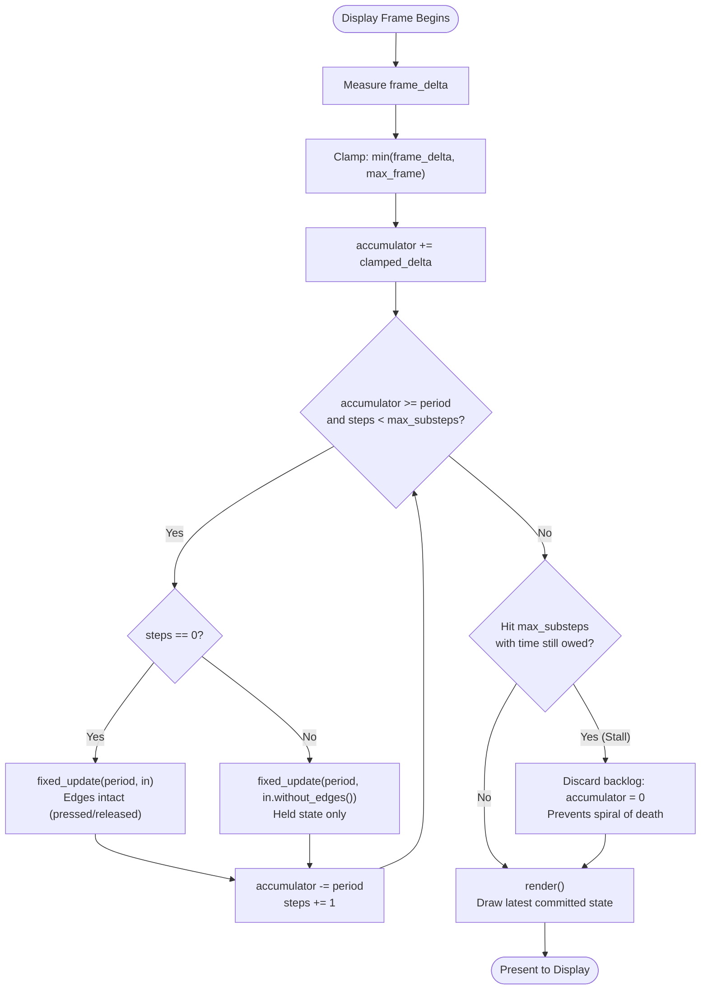

# The frame

Neutrino's default scene scheduler advances simulation in fixed time steps. A scene's
`fixed_update` receives a **constant** `dt` and may run zero, one, or several times per frame.
Rendering follows the updates and draws the latest state.

At the application boundary, `update_scene(float dt, const input_snapshot& input)` runs once
per frame with elapsed seconds and a freshly captured snapshot. Its default implementation
runs the scheduler described here. An override replaces it; Simplex uses this hook to call
`on_update(dt, input)` once per frame. See [Input](./input.md#where-input-is-delivered).

## Why not just use the frame delta?

Passing the real elapsed time straight into your logic is simpler, and it is what most small games
start with. It breaks in three ways that compound:

- **Physics stops being reproducible.** The same input on a 144 Hz machine and a 60 Hz machine
  produces different trajectories, because the integration steps differ. Bugs become unreproducible.
- **A stall becomes a teleport.** One long frame — a shader compile, the window being dragged,
  a breakpoint — hands your simulation a `dt` of half a second. Fast-moving bodies jump straight
  through walls that a smaller step would have caught.
- **Tuning stops transferring.** Jump heights and acceleration values found on one machine feel
  wrong on another.

A fixed step keeps the integration interval consistent; only the number of steps per frame
varies. This makes simulation easier to tune and reproduce, but reproducibility still depends
on the initial state, input sequence, randomness, and the simulation's numerical behavior.

## The loop

Each frame, the default `update_scene()` adds elapsed time to an accumulator, then drains it
in whole ticks. In this simplified pseudocode, `input` is the frame snapshot:

```text
accumulator += min(frame_delta, max_frame)
steps = 0

while accumulator >= period and steps < max_substeps:
    step_input = input if steps == 0 else input.without_edges()
    fixed_update(period, step_input)
    accumulator -= period
    steps += 1

if steps == max_substeps and accumulator >= period:
    accumulator = 0

render()
```

A remainder smaller than one tick carries into the next frame. The frame-delta clamp and
substep cap deliberately discard excess time during stalls, as described below.



See [Tutorial Step 1: A window and an empty scene](../tutorial/step-01-window-and-scene.md) to see this
loop running in a minimal application.

## Configuring it

```cpp
neutrino::application_config cfg;
cfg.fixed.period = neutrino::sim_duration{1.0f / 60.0f};  // 60 Hz simulation
cfg.fixed.max_substeps = 5;
cfg.fixed.max_frame = neutrino::sim_duration{0.25f};
```

| Field | Default | What it controls |
|---|---|---|
| `period` | 1/120 s | The simulation tick. Every `fixed_update` receives exactly this `dt` |
| `max_substeps` | 5 | Most ticks one frame may run, capping catch-up after a stall |
| `max_frame` | 0.25 s | Clamp applied to the frame delta before it reaches the accumulator |

All three are validated once at construction. A non-positive or non-finite value is rejected there
rather than silently producing a frozen or exploding simulation.

### Why two separate guards

They protect against different things, which is why neither replaces the other.

`max_frame` clamps a single pathological frame — the debugger pause, the window drag. Without it,
one such frame dumps a huge delta into the accumulator and the loop tries to run it all at once.

`max_substeps` caps sustained inability to keep up. When the loop hits the cap with time still
owed, the engine **discards the backlog** rather than carrying it. That choice matters: carrying it
means that below `1 / (period * max_substeps)` frames per second, the debt grows every frame,
the simulation falls further and further behind real time, and input latency climbs without bound.
That is the spiral of death the cap exists to prevent. Dropping the debt makes the game run in slow
motion during the stall — visibly degraded, but responsive and recoverable.

## Input across substeps

The application samples input **once per frame**. The default scene scheduler derives each
substep's input from that snapshot. A button press is a transition, and passing its edge to
every substep would let one-shot actions repeat within the frame.

So the engine splits the snapshot:

- **Substep 0**, if it runs, receives the full snapshot, including edges and wheel movement.
- **Later substeps** receive `without_edges()`: edges and wheel movement are cleared, while
  held state, axes, modifiers, and pointer position are preserved.

Live polling APIs such as `application::get_key()` and `get_mouse()` retain their frame-level
edges until frame completion. They do **not** receive this filtering and can repeat an edge
across substeps. Scene updates should read the supplied snapshot.

If a frame runs zero substeps, its edges and wheel movement are cleared without reaching a
scene update. Holding a key into the next stepping frame preserves `held`, but does not
recover `pressed`. The scheduler currently has no latch for those missed edges. The application
and Simplex per-frame hooks still receive the frame snapshot; see
[Input](./input.md#input-across-simulation-substeps) for the delivery rules and limitation.

## Rendering

`render()` is called once per frame, after any substeps. It draws the latest committed simulation
state.

There is deliberately **no interpolation factor**. A renderer that blends between the previous and
current simulation states produces smoother motion for continuous-resolution graphics — but
Neutrino's first target is integer-scaled pixel art, where a sub-pixel blend rounds away to nothing
at draw time. The parameter would be noise in every signature for a benefit the intended output
cannot show. If you are drawing at continuous resolution and want it, that is a reasonable feature
request, not a limitation you should work around by re-deriving positions in `render`.

## Common pitfalls

- **Advancing state in `render()`:** A frame rate variation, screen tear, or monitor refresh change
  alters your game's speed if state moves inside `render()`. Rendering is not a clock — it is an
  event that happens when the display hardware is ready.
- **Exceeding the catch-up budget:** Below `1 / (period * max_substeps)` frames per second
  (24 FPS with the default 5 substeps at 120 Hz), a frame can owe more simulation steps than
  the scheduler permits. Remaining backlog is discarded and simulation falls behind wall time.
- **Measuring time inside `fixed_update`:** Do not call system clocks like
  `std::chrono::steady_clock::now()` inside update logic. Physics and simulations rely strictly on
  integrating the constant `dt` provided by the engine.

## What this means for your code

- With the default scene scheduler, put simulation in `fixed_update` and drawing in `render`.
  Simplex instead calls `on_update(dt, input)` once per frame, with elapsed seconds.
- Treat the `dt` you are handed as authoritative. Do not measure elapsed time yourself.
- Do not assume `fixed_update` runs once per frame. It may run zero times, or five.
- Do not assume `render` runs between every pair of substeps. It does not.

## Next

[Scenes](./scenes.md) — what `fixed_update` and `render` are called *on*, and how the stack decides
which scenes receive them.
