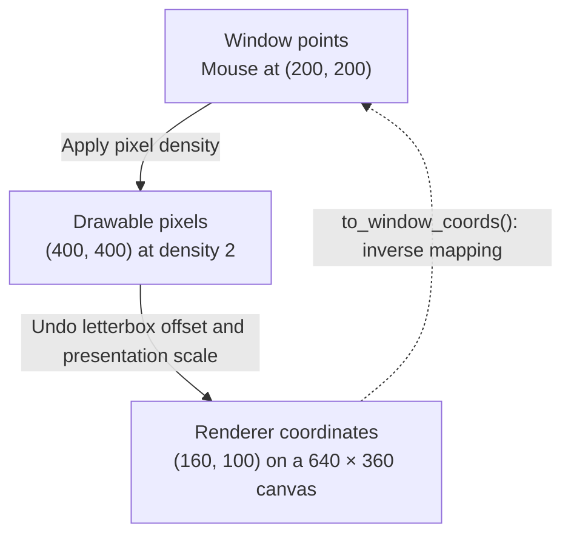
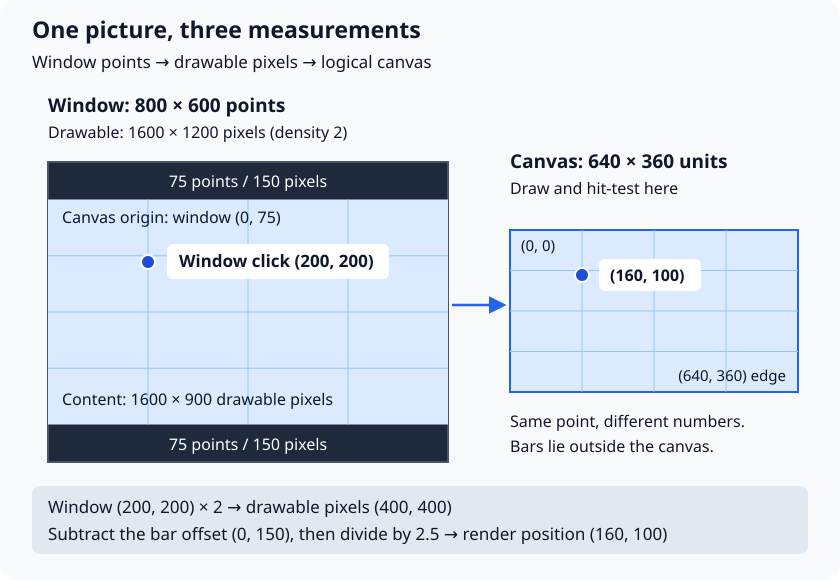
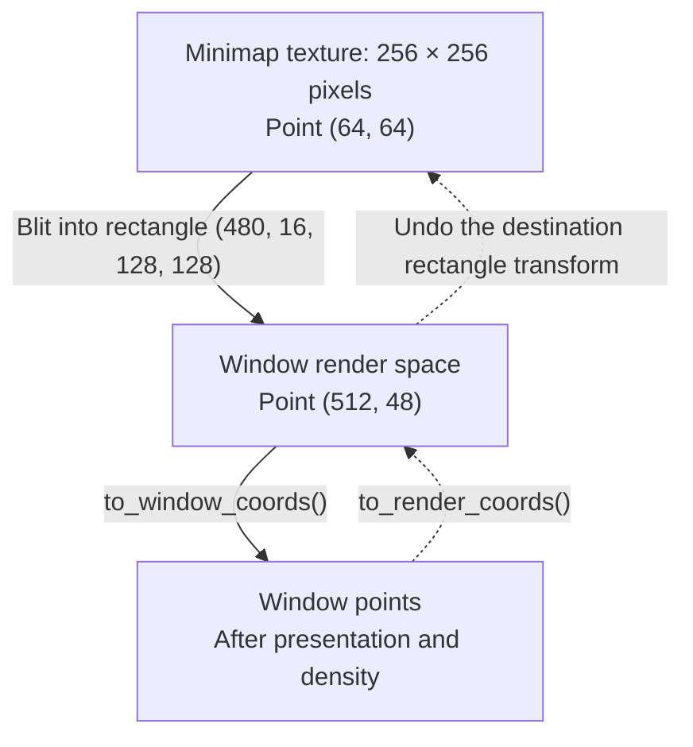

# Window and renderer coordinates

A window can be **800 × 600 points**, contain **1600 × 1200 drawable pixels**, and
show a game drawn on a **640 × 360 logical canvas**. All three sizes can be correct
at the same time.

The window tells the operating system how much space the application occupies.
The drawable tells the renderer how many pixels it can produce. The logical canvas
tells your game which coordinates to use for drawing and interaction.

For ordinary game code, lay out content using `render_size()` and hit-test it using
`input.pointer().render`. Neutrino maps the pointer through the window's presentation
transform for you.

## Three measurements of the same picture

| Measurement | Units | Use it for |
|---|---|---|
| **Window size and position within the window** | Window points | Initial window dimensions, raw mouse events, APIs that expect window-relative positions. |
| **Drawable size** | Physical output pixels | Understanding HiDPI density and the resolution of the window's rendering surface. |
| **Renderer coordinates** | Drawing units | Shapes, sprites, HUD layout, and hit testing. With logical presentation, these are your design canvas units. |

The default origin is at the top left: **x increases to the right, y increases downward**.
Window coordinates are relative to the client area, excluding the title bar and borders;
they are not desktop coordinates.



This diagram assumes the default viewport and renderer scale. The full conversion also
accounts for those settings, as explained [below](#viewports-and-renderer-scale).
Camera projection is a further, separate transform: see [coordinate spaces](./coordinate-spaces.md)
for world positions, camera movement, and the strong quantity types.

### Query the size you actually need

```cpp
#include <neutrino/video/globals.hh>
#include <stdexcept>

void inspect_sizes() { // Call from ready(), with the window as the render target.
    const auto window = neutrino::get_window().get_size<neutrino::dim>();
    const auto drawable = neutrino::get_renderer().get_output_size<neutrino::dim>();
    if (!window || !drawable) {
        throw std::runtime_error("Cannot query window or drawable size");
    }

    const neutrino::dim canvas = neutrino::render_size();
    // Example: window->width == 800, drawable->width == 1600, canvas.width == 640.
}
```

Call these helpers after the application's rendering services are available, such as in
`ready()` or scene callbacks. They are not constructor-time queries. Query the window's
output size with the **window as the render target**, before binding an offscreen texture.

`render_size()` reports the current logical presentation size if one is enabled. With the
window as the target and no logical presentation, it reports the **window drawable size**.
It does not calculate the visible bounds of a
custom viewport or divide those bounds by an explicit renderer scale. Offscreen targets
also need special care; see [render textures](#render-textures-add-another-space).

## Choose a canvas policy

### Reflow: a larger drawable gives you more room

Leave `application_config::logical_size` unset. In the default full-window view, one drawing
unit is one drawable pixel, and `render_size()` follows the drawable size.

This is useful for editors, inspectors, and games intended to reveal more content in a larger
window. Your layout decides what to do with the extra room. On a HiDPI display, reflow alone
does not keep a button the same size in window points: density-aware UI layout is a separate
choice.

### Fixed canvas: keep the same layout and fit it to the window

Set a logical size when the game should retain its design coordinates as the window changes:

```cpp
#include <neutrino/application.hh>

neutrino::application_config make_config() {
    neutrino::application_config cfg;
    cfg.title = "Coordinate example";
    cfg.width = 800;                         // Window points.
    cfg.height = 600;
    cfg.high_pixel_density = true;           // Allow a high-density drawable.
    cfg.logical_size = neutrino::dim{640, 360};
    cfg.scale = neutrino::scale_mode::letterbox;
    return cfg;
}
```

`high_pixel_density` requests support for a high-density drawable. It does not guarantee
a particular density; query the actual sizes. Density can change when the window moves
between displays.

| Fit mode | What happens | Typical use |
|---|---|---|
| `letterbox` | Preserve aspect ratio, show the whole canvas, leave bars where necessary. | A game or menu whose whole layout must stay visible. |
| `integer_scale` | Use a whole-number enlargement, preserving aspect ratio. | Pixel art; use nearest-neighbor texture sampling as well when crisp texels matter. |
| `overscan` | Preserve aspect ratio and fill the drawable, cropping canvas edges. | Content with a safe central area and expendable borders. |
| `stretch` | Fill the drawable with independent horizontal and vertical scales. | Content where distortion is acceptable. |

Integer presentation does not shrink below 1×. A drawable smaller than the logical canvas
can therefore crop it. The fit mode controls presentation geometry; it does not choose
texture filtering.

## Worked example: HiDPI and letterboxing

Use the configuration above and suppose the display supplies a density of **2 drawable
pixels per window point** on both axes. Keep the default viewport and renderer scale.



First, fit the logical canvas into the drawable:

```text
drawable size = (800, 600) × 2 = (1600, 1200) pixels
fit scale     = min(1600 / 640, 1200 / 360) = 2.5 pixels per drawing unit
content size  = (640, 360) × 2.5 = (1600, 900) pixels
bar height    = (1200 - 900) / 2 = 150 pixels = 75 window points
```

The top-left of the canvas is at window position `(0, 75)`, not `(0, 0)`.
To map a window position, first convert it to drawable pixels, subtract the content
offset, then divide by the fit scale:

```text
render_x = (window_x × 2 -   0) / 2.5
render_y = (window_y × 2 - 150) / 2.5
```

| Window position (points) | Drawable position (pixels) | Render position (drawing units) | Meaning |
|---|---|---|---|
| `(400, 300)` | `(800, 600)` | `(320, 180)` | Center of the canvas. |
| `(200, 200)` | `(400, 400)` | `(160, 100)` | Inside the canvas. |
| `(0, 75)` | `(0, 150)` | `(0, 0)` | Canvas origin. |
| `(400, 40)` | `(800, 80)` | `(320, -28)` | In the top letterbox bar. |

These numbers explain the transform. In code, use the helpers so SDL handles the actual
density, fit mode, and pixel rounding:

```cpp
#include <neutrino/video/globals.hh>

void convert_position() { // With the window presentation from the example.
    const neutrino::window_pos mouse{200.0f, 200.0f};
    const neutrino::render_pos canvas = neutrino::to_render_coords(mouse);
    // canvas == (160, 100)

    const neutrino::window_pos back = neutrino::to_window_coords(canvas);
    // back == (200, 200)
}
```

Both directions use the window renderer's current view. The inverse result is still
window-relative; positioning something on the desktop requires the appropriate additional
window-to-desktop conversion.

## Use case: click a button without clicking through the bars

The [input snapshot](./input.md#pointer-position-two-spaces) already contains the converted
position. Use it directly. `on_screen` indicates mouse focus/availability, including the
neutral input given to covered scenes; it does **not** mean “inside the logical canvas.”

Here is a hit test for a button on the `640 × 360` canvas:

```cpp
#include <neutrino/input/input_snapshot.hh>
#include <neutrino/video/geometry_types.hh>

bool button_clicked(const neutrino::input_snapshot& input, neutrino::dim canvas) {
    const auto& pointer = input.pointer();
    if (!pointer.on_screen) {
        return false;
    }

    const neutrino::render_pos p = pointer.render; // Already converted.
    if (p.x < 0 || p.y < 0 || p.x >= canvas.width || p.y >= canvas.height) {
        return false; // Outside the canvas, including letterbox bars.
    }

    // The button is drawn at {120, 80, 160, 40} in these same coordinates.
    const bool inside_button =
        p.x >= 120 && p.x < 280 && p.y >= 80 && p.y < 120;
    return inside_button && input.mouse(neutrino::mouse_button::left).pressed;
}
```

Pass the canvas size used by your layout. For the worked example,
`button_clicked(input, neutrino::dim{640, 360})` accepts the click at `(160, 100)`.
The per-frame application and Simplex update hooks receive the snapshot directly.
If calling from a scene's fixed update, also consider the
[fixed-step edge delivery rules](./input.md#input-across-simulation-substeps).

For raw mouse events, construct a `window_pos` from the event's window-relative x/y and
call `to_render_coords()` once. Do not feed `pointer().render` back into that conversion.
Raw touch positions are normalized: multiply them by the **window size in points** first,
then convert the resulting window position.

## Viewports and renderer scale

A **viewport** gives drawing a local origin and limits it to a region of the target.
An explicit **renderer scale** scales drawing coordinates. Both are separate from logical
presentation, which fits the overall canvas into the window.

For example, with density 1 and logical presentation disabled:

```text
viewport origin = (100, 50)
renderer scale  = (2, 2)
local draw point = (20, 10)

window position = (viewport origin + local draw point) × renderer scale
                = (240, 120)
```

The viewport origin is scaled too. `to_render_coords(window_pos{240, 120})` maps back
to `(20, 10)` while this window view is active. Neither conversion tests whether the
point is inside the viewport; perform that check separately.

This matters for split-screen views and editor panels. `input.pointer().render` is
calculated **when the snapshot is captured**. Changing the viewport later does not
recalculate that stored position. Keep `pointer().window` and convert it using the
intended window view, or explicitly apply your panel's transform to the stored position.
Respect `on_screen` in either case.

Restore temporary viewport and scale changes after drawing a panel, so the next pass
and the next frame's input sampling use the intended view. `render_size()` still describes
the overall logical canvas or drawable; it is not a query for the panel's local bounds.

## Render textures add another space

A `render_texture` has its own dimensions and drawing state. Binding one directs drawing
into that texture. Later, `blit(destination)` places the result in the window's render space.
Each target has its own viewport, scale, and logical presentation settings.



For a full-texture, axis-aligned blit without rotation or flipping:

```text
texture_x = (render_x - destination_x) × texture_width  / destination_width
texture_y = (render_y - destination_y) × texture_height / destination_height

texture_x = (512 - 480) × 256 / 128 = 64
texture_y = ( 48 -  16) × 256 / 128 = 64
```

First reject points outside the destination rectangle. This is useful for selecting a
location on a minimap, painting into an image preview, or interacting with a game view
embedded in an editor.

:::important[Window conversion does not pick a point inside a texture]

`to_render_coords()` and `to_window_coords()` use the **window's view**, even while a
texture is the active render target. Binding the minimap does not make these helpers
undo its blit rectangle. Apply that extra mapping yourself.

For texture dimensions, use `render_texture::size()`. For the pixel dimensions of the
currently bound target, SDL++ provides `get_renderer().get_current_output_size<dim>()`.
`render_size()` uses the current target's logical size when enabled, but otherwise delegates
to the renderer's output-size query; it is not a generic texture-size query.

Query window output dimensions before binding a texture. In the bundled SDL software
renderer, even `get_output_size<dim>()` can report the bound texture's dimensions. Using
`render_texture::size()` for texture layout avoids relying on that backend-specific behavior.
:::

See the [render texture tutorial](../tutorial/drawing/04-render-textures.md) for creation,
composition, and blitting.

### Simplex's canvas

Constructing a `neutrino::simplex::application` with `(320, 200, "Demo", 3.0f)` creates a
**320 × 200 drawing canvas** and requests an initial **960 × 600 point window**.
The final drawable pixel count depends on the display. Presentation uses integer scaling.

The adapter samples input before binding its canvas, and `on_update(dt, input)` receives
`pointer().render` in that canvas's coordinates. Resizing the window changes how the
canvas is presented; it does not change the canvas dimensions. Simplex already handles
its canvas presentation, so ordinary Simplex input needs no additional texture mapping.

## Use case: respond to resizing

In a scene, `on_resize(dim)` receives the **render-space size**, not the window size.
The application hook `resize_scene(dim)` forwards changes to the active scene by default.
A custom application can query its initial `render_size()` in `ready()` and override
`resize_scene()` to update its own layout; call the base hook if scene delivery is also needed.

With reflow, a changed drawable usually means a changed layout size. With a fixed logical
canvas, a window resize can change the bars and presentation scale while leaving
`render_size()` unchanged. Neutrino deduplicates these size notifications, so do not expect
a render-space resize callback for every window resize. Scenes receive an initial size
when activated.

If a feature depends on window points or physical pixels, handle the relevant window events
and query those dimensions explicitly. Avoid caching a density or bar offset indefinitely:
the mapping can change after resizing, entering fullscreen, or moving between monitors.

## Which space should I use?

| Task | Start with | Additional work |
|---|---|---|
| Place a HUD button | `render_size()` | Lay out and hit-test in the same render coordinates. |
| Aim at the cursor or drag a handle | `input.pointer().render` | Check availability and content bounds. |
| Select a world object | Render-space pointer | Apply the inverse of that view's camera projection. |
| Pick a minimap location | Render-space pointer | Undo the minimap destination transform, then its map projection. |
| Interact with a split-screen panel | Window-space pointer | Map into the correct panel view and test its bounds. |
| Anchor a window-relative UI element to a drawn point | `to_window_coords(render_pos)` | Supply the window points to the receiving API. |
| Inspect output resolution | Renderer `get_output_size<dim>()` with the window target active | Compare with window size to understand density. |

Keep positions as floats while converting and hit testing. Round only when the receiving
operation requires integer coordinates. Treat positions outside the canvas as meaningful
results to accept or reject deliberately, rather than clamping every pointer into the game.
